# **CCNA (cisco certified network associate)**

# LECTURE 01

**Difference between HARDWARE,FIRMWARE and SOFTWARE**
---

### **HARDWARE**

Hardware computer ka wo parts jinhy hum dhk skty hon touch kar skty hon.

e.g ; keyboard , ram , motherboard.

### **FIRMWARE**

- jab hardware chahy ram ho storage devices hun ya processor ho bnaia jata hai tou is ka andr phly sa hi aik **choty memory** hoty hai.kiun ka hardware bhut sary components sa mil kar bnta hai.

- in components ko mil ka kam krwany ka liye aik trha ka **type of software** keh skty hein lkin ya hardware specifc hai is hardware ko bna ka dal dia jaata hai.
- firmware ko hum **dhek** nai sktay **change** nai kar sktay use nai kar skty.
- **firmware hardware bnaty time dal dia jata hai bad mein change nai kia ja skta**.
- hum isy update kar skty hien lkin delete nai kar skty.
- update 3 trha ka ata hai 
  - aik jesy **playstore** pa rozana ki buniyad pa update aty hein
  - 2sra jesy **andriod** mein 5 6 mah bad update ata hai.
  - 3ra update ata hai jesy 6 mah bad ya 1 saal bad ka **firmware update** kry.

- har hardware ki apny aik memory hoty hai jis mein  **firmware** prra hota hai hum isy **access nai** kar skty.
- jab b hum **new laptop** lein ga ya naia motherboard lein ga tou wha pa jo **BIOS** hota hai wo aik firmware hi hai .
- us ka bad hum system pa operating systen install krty hein.
- OS ka bad hum is pa software install krty hein like ms office google chrome etc.
- OS b aik software hi hai system software or baqi ms office waqera application software hein.
- is sa b nechy jab hardware bnaia jata hai tou isy **bnaty time software dal dia jata hia isy khty hein firmware**.isy hum bad mein **change ya delete nai kar skty**.
- sary **electronic devices washing machine oven tv** mein b **firmwaare software** hota hai microprocessor ka andr b firmware software hoty hein.
- **simcard** mein b **firmwware** hota hai .
- **it is the heart of the device.**
- there is a **differece** between **bios and firmware**
- bios jab hum motherboard ko intially start krty hein tou operate krta hai bs.
- firmware har hardware component ka hota hai.
- firmware hardware pa store hota hai.
- firmware are usually in kb or 2mb 4mb.
- kiun ka ya sirf isy start krny ka liuye hoty hein.

**TYPES OF FIRMWARE**
---
1. **LOW LEVEL FIRMWARE**

- hardware ka basic functions control karti hai, hardware ka bhut close hoty hai
- it stored in ROM , PROM , EPROM , EEPROM .
- e.g : keyboard ka basic function.Keyboard, mouse, simple embedded devices

2. **HIGH LEVEL FIRMWARE**

- high level low level ka mutabik More complex instruction function provide krta hai 
- jaise router k networking or management function
- ya non volatile memory mein store hota hia
- ya flash memory ya EEPROM mein store hota hai
- Wi-Fi router, smart TV, printer

3. **SUBSYSTEM FIRMWARE**

- subsystem firmware specific hardware component ko control aur operate krta hai
- ya b hardware component ki non volatile memory mein store hoty hein jesy rom , flash memory , eeprom .
  

### **SOFTWARE**

- collection of instruction that tell the computer what to  do .

- software user accessible memory mein hoty hein mtlb ka user access kar skta hai lkin firmware ko access nai kar skty hai

# LECTURE 02
**TRANSMISSION MODES**
---
**TRANSMISSION MODE** mean transferring of data between two devices.

### **SIMPLEX MODE**

**communication is unidirectional** 

e.g : TV , FM RADIO, KEYBOARD.

### **HALF DUPLEX MOE**

e.g : police radio.

### **FULL DUPLEX MODE**

both device can **communicaticate simultanauoesly** but the capacity of link is shared between two of them.

- agar 2 mbps speed hai tou 2no devices aik aik mbps sa send kara skty hein.

# LECTURE 03

**OSI MODEL(open system interconnection)**
---
**1976** mein **ISO(international standard organization)** na isy develop kia.**1986** mein  hum na isy implement kia implement b nai keh skty kiu ka hum isy **referece model** ki trha consider krty hein jo practical implement kia wo hai TCP/IP .

**(All People Seems To Need Data Processing)** for remembering osi layers.

- it have **7 layers**.

- agr ap **sender** hein tou phly layer ho gi **application layer**.
- agr ap **receiver** hain tou phly layer ho gi **physical layer**.
- **APPLICATION LAYER** imagine hamry pass aik company hai is ka CEO Andy hai  or ya french hai. ceo na parvez sa kha mujjhy 400 bhut important page dusry xyz company ko send keny hain.aj hi bhjny hein.
- baqi hum man lety hain ka 6 bndy is ka employee hein 
- **PRESENTATION LAYER** parvez na dhka ya 400 pages french mein hein or smny waly company indian hai tou us na isy english  ma translate translate kar dia.
- **SESSION LAYER** sammeer parvez na kam karky sammer ko bhj diye or btaia ka 400 pages hein or bhut hi important hein aj hi bhjny hrin humy or isy translate b kar diya sameer na dhka ka ya pages delhi mein jany hien or iski company newyork mein hai sammeer na smny waly company mein apny equilant bndy sa kha ka aj apki company khuly hai kitny bjy tak khuly hai tou kuch document ayein ga jab receive ho jayein tou bta dejiye ga.

- **TRANSPORT LAYER** tanveer sammer na document transfer kar diye tou tanveer na dhka imp documents hein tou is ka segment bna diiye 4 envelop 1 2 3 4 100 pages ka

- **NETWORK LAYER** naveen tanveer na naveen ko da diye naveen na dhka ka 4 envelop aye hein us na isma to or from ka address dal dia ka dhky kha sa ayein hein or jany kha hein or rasta bta dia jo sahi hai
- **DATA LINK LAYER** denaish ab envelop denaish ka pas a gia is na dhka ka ya tiu khuly huvy koi b dhk skta hai tou is na apna sign lga dia

- **PHYSICAL LAYER** pavan denaish na isy envelop dia or pocha ka naveen na tumhy rasta bta dia hai ya nai paavan na 4ro envelop rkhy or btaye hovy rsty sa delhi phuncha or xyz companyy ko da dia
- is na agly company ko dia **physical layer** ko us na 
- us na agy department mein transfer kar dia **data link** mein wha pa chk howa seal sai hai koi cherkhani tou nai hoi.
- **network layer** mein us na dhka ka ya humary pas hi any thy address bilkul sai hai kia to or from chk kar ky agy bhj dia
- **transport layer** na dhka ka ha agye yhi hein 4 envelop ko organize kia or agy da diye
- **session layer** na dhka ka document a gye hein tou is na company mein inform kar dia ka g document receive ho gye.
- tou company ki t4ension kthm hoi ab unka ceo prhy na prhy inki tension nai hai

**the way how this system work**
---
**APPLICATION LAYER**
  
  - jitny b software istemal krty hein ya sab application ma aty hein jesy chrome facebook calculator etc.
  - application layer humy communicate krny ka liye facility provide krwata hai by using protocol .
  - **Applications ko network par communicate karne ke liye services provide karna.**
  -  ya user ko interface provide krwaty hein. is layer pa user kam krta hai agr hum na koi mail bhjny hai tou email sa bhjy ga tou ya email aik applicaation layer hai.
  -  bhut sary **protocols** hein jo is layer pa kam krty heun jesy **HTTP , FTP , TELNET** etc.

**PRESENTATION LAYER**
  
-  mein **encryption or decryption** ka kam hota hai.
-  is layer mein is na data ko **translate** kia tha.
-  is mein ya btaia jata hai ka **data ko represent** kesy krna hai.
-  isi layer mein **compression or decompression** hoty hai

**SESSION LAYER**

-  mein data **end to end encrypted** hota mtlb ka ya sary model pa nzr rkhta hai data aik layer dsry layer tak phunch jaye ya is baat ko ensure krta hai 
- oper ki 3no layer ko **software layer** b kha jata hai yha pa software sa kam hota hia 
-  nechy ki 3 layers ko **hardware ki layer** kha jata hai kiu ka yha pa hardware component sa kam hota hia.
- ya session chalta hai sender device or receiver ka darmian jesy aik device ko dusry device sa communication ko krwaty hai usy mange krty hai or isy end krty hai
- **checkpoint**  agr data long distance mein send krna ho tou Checkpoint use hoty hein communication mein ek save point hota hai, jahan progress record hoti hai taake interruption ke baad appropriate point se continue kiya ja sake
  

 **TRANSPORT LAYER**

-  ko **Heart of the layer** kha jata hai .ya dono ko support krta hai. 
-  yha pa **segmentation** hoty hai. 
-  yha pa 2 bhut important protocol ka istemal hota hai.
-   **TCP(transmission control protocol)/UDP(user datagram protocol)** 
    - agr hum data **retransmit** krna chty hein tou ya data ki **acknowledgement** chty hein ya data **loss na ho** tou hum **TCP** istemal kry ga.
    - agr hum chty hai ka **data fast transmit** ho tou hum **UDP** ka istemal kry ga e.g; video call ya youtube pa video dhkna chahty hein.
- **PORT NUMBER** port num device mein jis jaga jana hai wo btata hai

**NETWORK LAYER**

- **router** is layer pa kam krty hein. **ip address** is layer pa kam krty hein.
- data ko kis route sa jana hai ya b isy layer mein decide hota hai
- yha pa **data packets** mein devide hota hai 
- packet mein hae segement pa sorce or destination ip lga ka agy transfer kia jata hai

**DATA LINK**(frame)

Three main function of data link is;
1. **transmission error** chk krta hai ka during transmission data chory tou nai howa
2. **flow of data** sender ki speed ko receiver ki speed sa match krta hai
3. **well defined interface** do components ka darmyian clear communication ka rule.
4. **frames** mein packet pa mac source address or mac destination address lgaia jata hai. 

**PHYSICAL LAYER** 

Physical layer mein **data bit or byte** sa signal mein convert ho ka wired ya wireless connection sa transfer ho jata hai.

# LECTURE 04
 **TCP/IP MODEL**
 ---
 **TCP stand for transmission control protocol and IP stand for internet protocol.**

 - in dono ka **combination** ko **TCP/IP MODEL**  khty hein.

- jab 2 devices internet pa baat kar rhy hoty hein tou ya in protocols  ko use kar rhy hoty hein.
- **TCP transfer layer** pa sport krta hai ya **acknowledgement** provide krta hai ka data transfer ho rha hai ya nai ho rha or seequencing kia hai.
- **IP internet layer** pa sport krta hai hamra destination kia hoga humra path kia hoga router ka ip kia hoga  
- **TCP/IP OSI sa nai bna** 
- **TCP** america ki defence DoD team isy bna rhy thy .
- isy bnany ki **wja** ya thy ka phly laptop mein dependencies ka msla tha dell ka laptop dell sa hi baat kar skta tha or america ka laptop europe ka laptop sa communicate nai kar skta tha

**TCP/IP model**  
--

**another model of TCP/IP**
---

important points
---

REASON WHY WE NEED TCP/IP MODEL
---
- Data network pa transfer kesy ho ga

- iska format kia ho ga dusra computer smjh sky jesy phly america ka laptop europe ka laptop sa baat nai kar skta tha 

**Two important features which help building tcp/ip model to decemntralized a cetralized network**

- **END NODE VERFICATION** aik esa network ho jis mein sirf jha sa data jana hai or jha pa jana hai address pata ho is ka andr ka kis kis route sa jana hai is ki zrurt na ho esa system bnanana hai .
- **DYNAMIC ROUTING** mtlb ka destination par jany ka liye bhut ziada route hony chyie.

- american chty thy ka un ka data sender sa receiver tak successfull phunch jaye or kisy ko ya malom na ho ka data kidr kidr sa ja rha hai.

issuse that were resolved by tcp/ip
---
- **ADDRESSING** is mein pata huna chyie ka data kha sa arha hai or kha ja rha hai or data sai jaga par phunch jaye.

- **ROUTING** ka ya mera pakage hai ya kha sa jaye ga.
- **NAME RESOLUTION** is mein agar hum google par search krty hein **www.facebook.com** tou **DNS** is nam ko backend pa **IP**
like **121.10.30.10** mein change kar da ga kiun ka router nam nai smjhta router **ip address smjhta** hai.
- **FLOW & ERROR CONTROL** device ki capacity ka mutabik data transfer hota hai.
- **INTEROPERABILITY** is mein different different protocols different different contries sa hum communication kar skty hein.

**in problems ko hum na TCP/IP sa solve kia tha** .

**TCP/IP layers** explain
---

***APPLICATION LAYER***

- skype , facebook , gmail jitny b **applications** hein wo isy pa layer pa kam krty hein.

- jo important protocols hein wo hein **DNS, DHCP, HTTP, FTP, TFTP, SMTP, SNMP**  jesy **http/www.facebook.com** . 
- User applications ko network par communication ki services provide karna.

***HOST TO HOST/TRANSPORT LAYER***

- Host to Host layer pa jo protocol kam krty hein wo haiN **TCP And UDP** 
- yha pa **segmentation** hoty hai.
- **PORT NUMBER** port num device jis jaga jana hai wo btata hai
  
  **FEATURES of TCP**
  
    - **connection oriented** means ka jab sender kuxh data bhjy ga tou receiver or sender ka darmian aik connection establish ho ga wo btata rhy ga ka packet receive ho gia ya nai .
    - agar kuch data loss hogia ho jesy packet1 2 or 3 phunch jaye 4 na phunchy tou receiver btaye ga ya dubara **retransmit** kar da ga.
    - **non real time** data mtlb ka zrury nai ka data usy wqt receiver dhkky jitny b documents pdf hein wo TCP sa hi transfer hoty hein.
    - it is **slow in comparison** to udp.
    - it is **relaible**.
- 
  **FEATURES OF UDP**
  
    -  ya fast data transmit krny ka liye istemal hota hia 
    -  is mein data retransmit nai hota 
  
 _**INTERNET LAYER**_ 
- Yha pa **IP** protocol istemal hota hai 
  -  **ip** sender or receiver ka ip address btata hai 
  - **routing** ka btata hai kis route sa jana hai ya kon sa route bhtr ho ga
  - sender or receiver mein communication establish krwana.
- protocols used in internet layer IP/ARP/RARP/CMP/GHP .
  

***NETWORK  LAYER***

- Yha pa MAC Address ka istemal hoga
-  frames bnty hein
-   bits sa signal mein data convert ho ga.

---
**1970 Mein 2 network hoty thy aik LAN  or 2sra tha ARPAnet bad mein isy DARPAnet kar dia ya US DEFENCE is network pa kam krta tha is pa inhu na tcp/ip model implement kia jo successful howa bad mein nhu na universties or saby  government department mein networking ka liye b use krny lgy jisy bad mein baqi logo na b isy pa kam krna shiru kar dia or internet par yhi protocol istemal hota hai ab communication ka liye**

# LECTURE 05

- **OSI** ka **physical layer** pa 2 deivces kam krty hein aik hai **HUB** or dusra hai **REPEATER** . **layer1 devices**

- **data link** layer pa **bridge or switch** kam krty hein **layer2 devices**
- **network layer** pa **Router/layer-3** **switch** kam krty hein **layer3 devices**
- **baqi layers** pa **gateways** kam krty hein ziada tar kam application layer pa kam krty hein.

### **LAYER 1 DEVICES**

**HUB**
---

- hub aik aisy device hai jis sa baqi computers connect hoty hein **star topolgy** ki trha.

- hub ka kam hai connected device ka darmian **connection establish** krwana.
- hub ka**2 4 ya 8 port** hoty hein.
- **Always broadcast** ya aik esy device hai agr humy koi information  bhjny hai tou ya sabhy device ko forward kar da gi toou jis device ka address hota wo accept kar leta baqi reject kar dety.ya **intelligent device nai** hia
- ya **physical layer** pa kam krtta hai.
- hub **electrical signal or binary** dono ko send kar skty hein
- hub **half duplex** mein kam krta hai.
- **single collision domain** aik time pa sirf aik kam hi hoga
- hum isy **local area network** mein istemal kar skty hein
- it cannot store **mac address**.
- **Active  hub** 
    - active hub ko chalny ka liye elctricity chyie
    - it will amplifies(signal ko strong krta hai) analog signal 
    - or agr digital signals hein tou ya regenrate kar da ga
    - repeator signals ko regenrate karky agy transmit kar deta hai like 10*2 ki wire hai uski range hai 185m wo yha tak signal transmit kar skty hai is ka agy aik repeator lgai a jo weak signal ko regenrate karky agy 185m tak transmit kar dy ga.
- **passive hub**
  - it does not required electricity
  - it does not amplify signals it will send and receive as it is 
  

### **LAYER 2 DEVICES**
**BRIDGE**
--

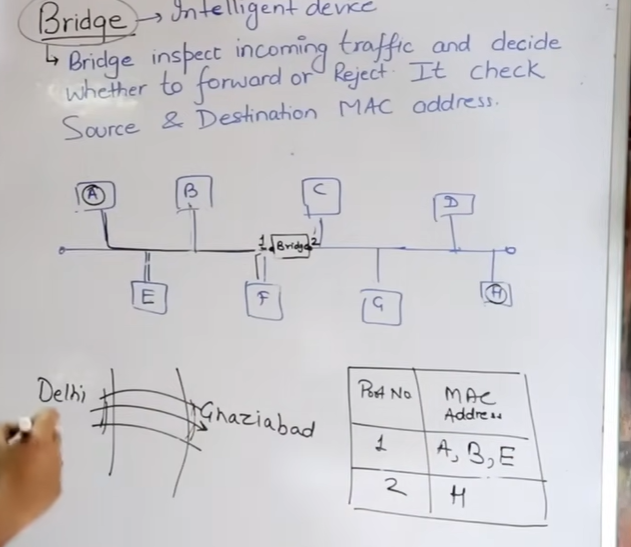

- Bridge is a **little more intelligent** then hub
- bridge ka **2 port** hein
- bridge can **read** data with help of **mac address**
- bridge phly bar broadcast krta hia phir jab mac address save ho jata hai tou jis port ki trf device ho us trf broadcast krta hai 
- bridge chk krta hai ka message forward krna hia ya reject krna hai is base pa ka agr message port1  mein forward krna ho tou wo ddhky ga agr device port1 mein hi hai tou wo reject kar ky port11 mein broadcast kar da ga.
- **data link** layer pa **mac address** kam krty hein
- used to connect a lan multiple network segment or lan seegment 
- **filter data trafic** ya dhkta hia ka left pa broadcast krna hai ya right pa
- bridge reduce the amount of traffic on a lan by dividing it into segment.
- it has two collision domain.

### **LAYER 2 DEVICE**

**SWITCH**
--
- **Switch** is an **intelligent** device

- switch network mein har device dusry device sa  connect hoty hai jis ki wja sa is mien collision nai hoty
- switch has its table jisy hum khty hein **content assessible memory** **CAM**  table b khty hein ya maintain krta hai table ko jis mein port number or mac address save hoty hein
- Switch can use (**ASIC** Application specific integrated circuits) jo specfic task perform krny ka liye chip hoty hai
- switch b first time information collectkrny ka liye  broadcast krta hai phir jab devices ka mac address save ho jata hai tou phir direct communicate krwata hai devices ko.
- agr new device switch mein lgai tou wo port no pa dhka ga device ka mac address automatically change kar la ga.
  

- **maintain cam table** 

- **first broadcast then unicast & multicast** multicast mean agar mery pas 8 bndy hein or 4 ko multicast aik sth hi msg snd kar skty hein
- every port of switch is **separate collision domain** mtlb hr kisy ka ps apna rsta hai collision nai ho gi
- switch has one broadcast domain means ka agr kisy na sbhy ko msg/data snd krna hai tou wo sirf aik bnda hi snd kar skta hai aik time ma
- **ports 2 4 8 16 48** 48 maximum hein.
- **slow hota hai** 
- **wireless tansmission** mein speed **10mbps** or **wired connnection** mein **100mbps** hoty hai.

**TYPES OF SWITCH**
--

1. **STORED AND FORWARD SWITCH**
    - ya phly value stored krta hai check krta hai phir forward krta hai is liye thora slow b hai
    - lkin ya sab sa reliable hai jis ki wja sa market mein sab sa ziada use hota hai

2. **CUT THROUGH SWITCH**
    - ya sirf data link layer ka frame ko chk kry ga chk krny ka bad usy jha b bhjna hai mac address jha ka b hai ya wha pa forward kar da ga. 
    - ya reliable nai hai lkin ya fast bhut hai kiun ka check kiye baqair hi bjy ja rha hai 

3. **FRAGMENT FREE SWITCH**
    - Is switch mein ya phly ka 64 bytes chk krta hai
    - ya header hota hai data link file ka 
    - in mein agr error ho tou wo b findout ho jata hai or mac address dhk ka agr forward kar deta hai.

4. **ADAPTIVE SWITCHING**
    - Is mein kuxh nai hai bas jis switch ki zrurt hai ya us krha kam krny kag jaye ga.

### **LAYER 3 DEVICEs**

**ROUTER**
---

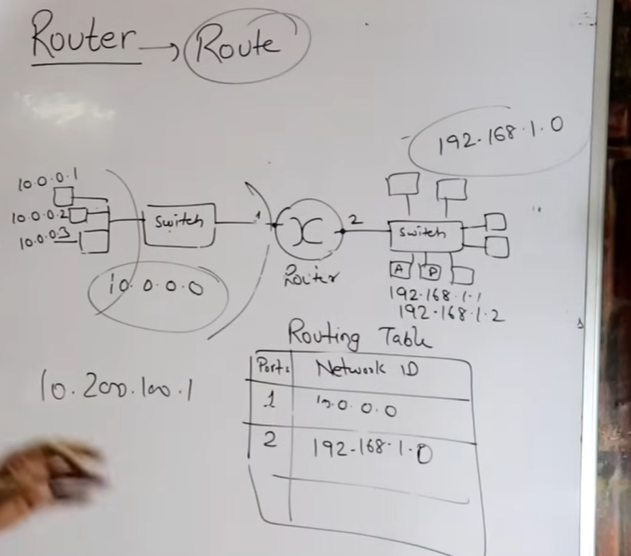

- Router 2 different network ka darmian communication krwata hai.

- router ka har port pa network ki  different I'D hona lazmi hai.
- router ko hum lan mein istemal nai krty blky hum isy WAN mein ya internet pa istemal krty hein
- router ka har port mein aik apna broadcast domain hota hai.yani msg sab ko bhjny ka liye. 
- ya information packet ki form mein bhjta hai
- packet mein jab aik or heeader add ho jaye tou ya frame bnta hai.
- it have 2 4 or 8 ports.
- ya fast hota hai 10/100/1gbps aty hein.

**GATEWAY**
---

Gateway  network par enter ya exit point hoty hein kisy network mein any jany ka liye.

# LECTURE 06

**NETWORK TOPOLOGY**
---

- network topology ka mtlb hai **design of network**.

1. **PHYSICAL TOPOLOGY**  Humna jo computer lgae hein wo dhkny mein kesy lag rhy hein circle mein hein line mein hein ya kesy hein.
2. **logical topolgy** mein internally devices apas mein kesy communicate kar rhy hein 

**types of topology**
---

**there are 6 types of topology :**

1. MESH
2. BUS
3. RING
4. TREE
5. HYBIRD 
6. STAR

- sab sa ziada bus mesh or star topology istemal ki jaty hai.

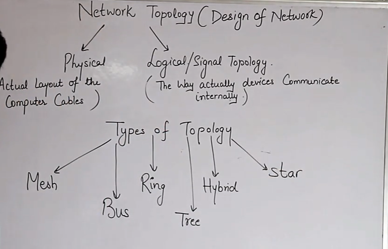

### 1. **MESH TOPOLOGY**

- Each computer is connect to every other computer .

- ya choty network ka liye perfect hai bry network mein khracha or kam bhut messy ho jaye ga
- ya bhut **secure** hai.
- high level of redudancy mtlb ka agar aik path break howa hai tou baaat krny ka liye isky pas bhut ziada paths hoty hein.
- partial mein aik computer sab ka sth connext nai hota ya partial mesh topology ho jata hai
- full mesh mein sabhy aik dusry sa connect hoty hein
- wiring is very complicated

### 2. **BUS TOPOLOGY**

- bus topology mein aik hi trunk cable sa bhut sary PCs apas mein T-conector ka zaariye connect hoty hein 

- co-axial cable sa ya connect hoty thy 
- ya  choty network la liiye best hai 
- required less cable
- ya koi device use nai krty isy liye ya secure nai hai 
- ya koi device use nai krta jis ki wja sa isma broadcasting ho gi
- agr cable break ho gai tou pora network break ho jaye ga.

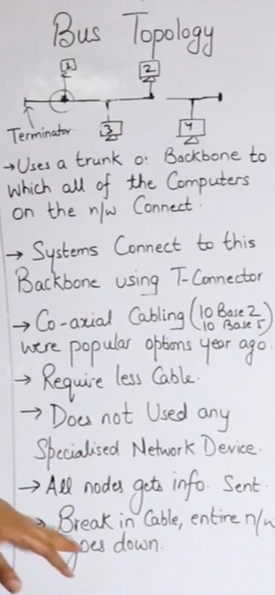

### 3.**STAR TOPOLOGY**

mostly used topology.

- is mein aik centralized device used hoty hai jis sa computer connect hoty hein ya hub b ho skty hai or switch b

-  agr hub used hoi tou is ya broadcast kry ga switch nai krta
- humy sirf computer ko device sa connect krna hia baqi computers sa connect krny ki zrurt nai hai.
- lan topology mein sab sa ziada istemal hota hai

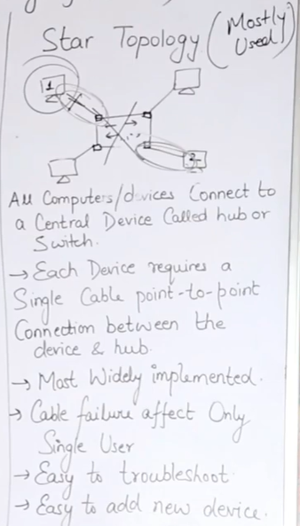

### 4.**RING TOPOLOGY**

- ring topology mein devices ring ki shape mein connect hoty hein
- is mein aik device lgy hoty ahi jisy hum **MSAU (multistation access unit)** khty hein.
- MSAU aik token provide krta hai jab device ka pas token ho ga tabhy wo communicate kar skty hai or ya token circle ma move krta hai
- is mein collision ki problem solve ho gai thy
- ya physical ring hi hota hai lkin logical ya star ki trha kam hi krta hai 
- is mein information clockwise move krty hai sender sa receiver ki trf

### 5.**HYBIRD TOPOLOGY**

- combination of two or more topology is hybird topology.

- jab hum existing networks ko change nai krna chty or in mein connection b establish krna chty hein tou hum hybird topology istemal krty hein.

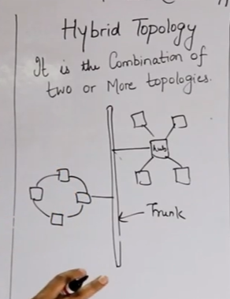

### 6. **TREE TOPOLOGY**

**it is a combination of bus and tree topology.**

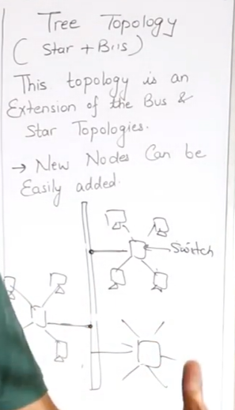

# LECTURE 07 

**LAN , WAN , MAN**
---

***WAN***

- agr 2 computer **communicate** kar rhy hein **internet** sa chahy aik hi room mein beth ka ya aik lhr mein ho or aik islamabad mein tou wo **WAN(wide area network)** ho ga.

- wan has a minimum speed
- most verneable network attack or viruses ka chance sab sa ziada hon ga
- routers or switches wan mein use hon ga
- WAN
- jab b hum **communication** ka liye **internet** use kry ga tou hum **LAN** use kry ga
- **WAN** satellite , optical fiber cable sa establish kia ja skta hai

***LAN***

- agr 2 computer **communiate** kar rhy hein chahy aik islamabad ho or aik lahore mein ho lkin agar **wired connection** hai  wire ka zariye chy wo ethernet ho ya fiber optic cable ho lkin ho wire tou wo **LAN(local area neetwork)** ho ga. ya  wan bny ga kiu ka network geographical area pa depend krta hai ka kitna area hai .

- Lan has a highest speed , maximum speed
- most secure network
- router use nai hoty blkky switch sab sy ziada istemal kia jata hai
- hum lan mein fiber optic , ethernet , co-axiable cable istemal kar skty hein
- lan local area network hum aik campus mein use krty hein switch ka zariye sa.
- hum **LAN** mein wire ka ilawa b aik room mein bethy hovy baat kar skty hein router ka zaariye router mein 3 functions hoty hein 
  - router jo internet ka zariye communication  krtwata hai
  - switch jo wired connection ka zariye communication krwata hai
  - access point jo wireless like a bluetooth communication krwata haai

- jab hum reperater/signal tower sa communicate krty hein tou wo b lan mein krwata hai 

***MAN*** 

- Agr aik hi city mein 3 4 buildings ko wired zariye connect kia jaye tou isy MAN kahy ga.
- everthing is moderate
- man mein b ethernet istemal krty hein

# LECTURE 08

**MAC ADDRESS**
---

- **MAC(media access control)** mobile ka hota hai

isy or b bhut namo sa jana jata hai 

1. **PHYSICAL ADDRESS** laptop/pc mein milta hia
2. **HARDWARE ADDRESS**
3. **BIA (burnt in address)** ya cisco ka router switches mein milta hai

there are two types of address
--
1. **physical address** jesy nam
2. **logical address** jesy kha pa rhta hai

  - mac address is globally unique

- mac address laptop ka nai blky is mein lgy interface card ka hota hai.
- humary **ethernet port , bluetooth, or wifi** in 3no ka **mac address** hota hai.
- laptop mein jitny **interface card** hon ga utny hi **mac address** hon ga
- mac address  **64 bits** ka hota hai

- **MAC ADDRESS** is represented in **HEXADECIMAL format**.

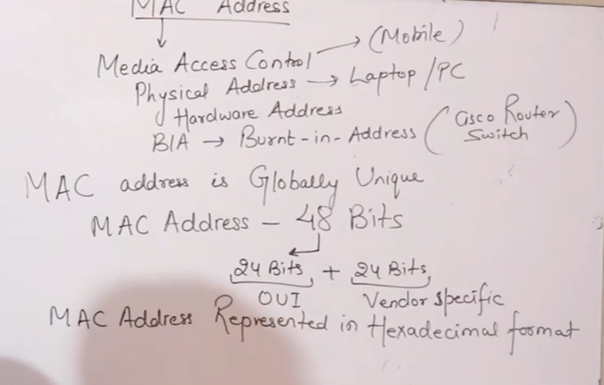 

- **64 bits** 2 parts mein divide hoty hai **24 bits OUI(organization unique identifier)** ka or **24 bits VENDOR SPECIFIC** ka lliye hoty hein.

- mac address 12 heximal characters ka hota hai

- 1 hexadecimal character mein 4 bits hoty hein
- starting ka 24 bits leny ka liye ya companies  **IANA** (Internet Assigned Number Authority) sa request krty hai.
- Isy liye alg hoty hein kiun ka IANA  same address provide hi nai kary ga
- starting ka 6 character jo IANA deta hai hamesha alg alg hon ga ya same nai ho skty.
- agar dell na  laptop manufacture krny shiru kar diye tou phly ka **OUI** number jo usy **IANA** na assign kiye hain ya whi likhy ga or **vendour specific address jo hexadecimal character change** ho ga jab vendour specific ki limit pory ho jaye gi tou wo IANA sa new number ki request kry ga.

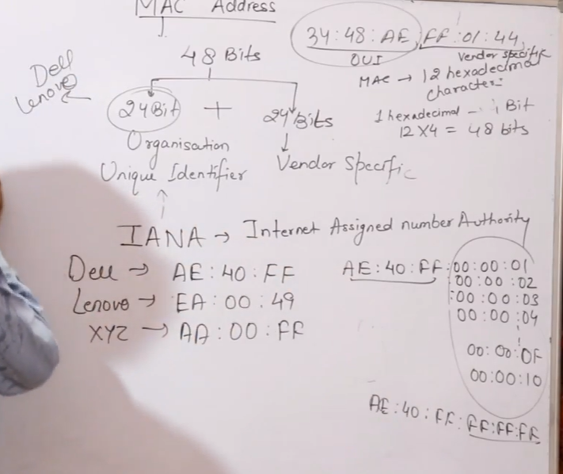

**how can we represent hexadecimal**
---

DEECIMAL | HEXADECIMAL | BINARY
---------|----------|---------
 0 | 0 | 0000
 1 | 1 | 0001
 2 | 2 | 0010

- **BINARY  mein 8 4 2 1  0000 , 2  0010 , 3 0011 , 4  0100 , 5  0101 , 6  0110 ,  7  0111 , 8  1000 , 9  1001 , 10 ka liye hexadecimal  A , 11  hexadecimal  B ,12  C ,13  D , 14 E ,15 hexadecimal F** .

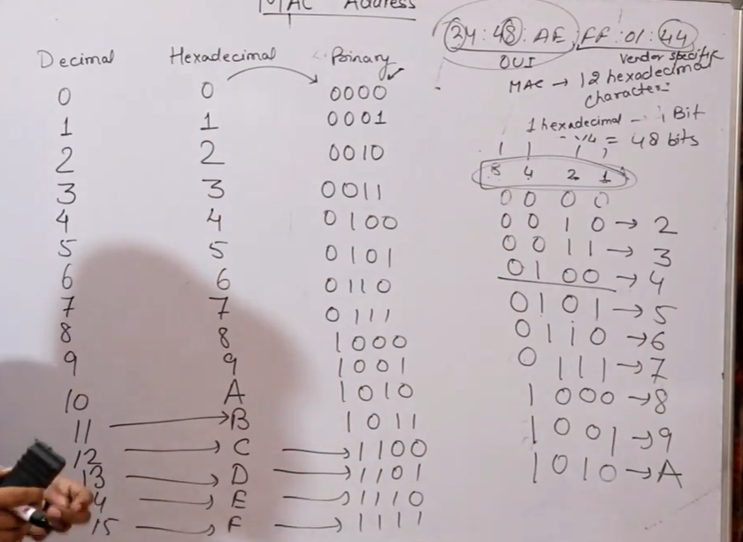

**breakdown HEXADECIMAL INTO BINARY**
---
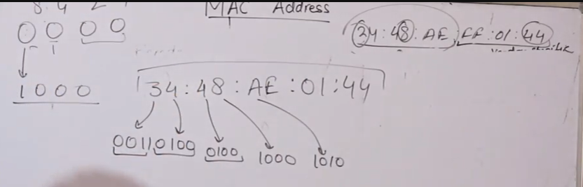

**BINARY INTO HEXADECIMAL**
--
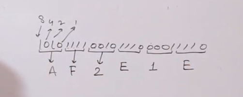

**MAC ADDRESS** hamesha **HEXADECIMAL**  mein represent kia jaye ga.

- **SWITCH** ka **unique** MAC address hota hai.

- **ROUTER** ka **ports/interface** ka alg alg MAC ADDRESS hota hai.
- **MAC ADDRESS** dhkny ka liye ap **search**  mein ja ka cmd mein **run as admiministrator** kry phir command den `ipconfig/all`  kry ga tou nechy physical nam sa mac addresses a jayein ga.
- **BROADCAST MAC** FF:FF:FF:FF:FF:FF is the broadcast MAC address. It is used to send a frame/message to all devices on the local network.

# LECTURE 09

**IP ADDRESSING(internet protocol adressing)**
--

Addressing 2 trha ki hoty hai

1. **physical addressing**(jesy agr kisy bndy sa milna ho tou shehar mein ja ka us ka sirf nam pochna is ka dam pa hum location pa nai phunch skty)
    - is mein **MAC ADDRESS** ata hai jo 48 bits ka hota hai
2. **logical addressing**(is mein kha rhta hai kis area mein hai arrea mein kis jga par hai proper address)
    - is ka 2 version hoty heein 
    -  1. **IPv4** 
    -  is mein further **2** classes hoty hein
    -  - **PUBLIC IP ADDRESS**
    -  - **PRIVATE IP ADDRESS**
    -  2. **IPv6**

**1. IPv4**
---

- **ip** hi wo chz hai jis sa hum **network** pa **aik jga sa dusry** jaga jaty hein

-  agr hum na koi msg delhi sa islamabad tak bhjna hai tou hum **IP** ki madad sa bhj skty hein.
-  ya **32 bit** ka hota hai
-  is mein **4 octet** hoty hein
-  ya **0 - 255** tak ki value hoty  hai
-  **IP Address** 2 cheezo sa mil ka bna hai **NETWORK ID + HOST ID**
-  **IPv4** kuxh `192.168.39.40` is trha sa likha jata hai 
-  is mein har dot sa phly ki value aik octet hai **aik octet 8 bits** ka hota hai
-  **Class A** IP Address  `20.100.200.15` is trha ka likha hota hai ya `1.0.0.0` sa la ka `126.0.0.0` tak hoty hai
-  **Class B** ip address `145.160.20.10` is trha ka likha hota hai ya `128.0.0.0` sa la ka `191.255.0.0` tak hoty hai.
-  **Class C** ya `192.0.0.0` sa la ka `223.255.255.0`tak hoty hai
-  **Class D** ya `224` sa la kar `239` tak hoty hai ya **multicast** ka liye istemal hoty hai
-  **Class E** ya `240` sa ka kar `255` tak hty hai ya **research** ka liye istemal hoty hai
-  ip `127.0.0.0` ya **Loop back address** hai is mein hum cmd mein ja ka  chhk kar skty hein agr internet nai arha tou kia ya mery **network interface card** ka msla hai ya network pechy sa hi nai arha .
-  phly octet mein kabhy b hum zero nai lety

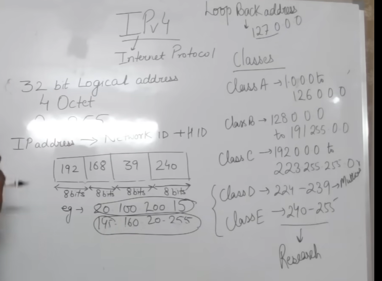

**how to check ip belonged to which class**
---

- jesy `137.0.0.0` mein hum sirf phly octet ko dhky ga ki avalue hai us ki base pa hum ip ki class btaeye ga tou y **CLASS B** kaa ip address hai.

**NETWORK I'D KESY FINDOUT KRTY HEIN**

- **CLASS A** ( N . H . H . H ) class A mein phly octet network ka liye reserved hota hai baqi ka teen host ka liye hoty hein.

- **CLASS B** ( N . N . H . H ) is mein phly 2 octet network ka lliye reserved hoty hein baqi ka 2 host ka liye 
- **CLASS C**  ( N  . N  . N  . H  ) mein phly 3 network k liye last host ka liye.
- aik ip lety hein `115.10.0.15` is ki class chk kijiye ya class A mein a rha hai tou **class A** mein phlly octet network ka liye reserved hai tou phla octet wesy hi likh ka baqi octet zero kar dein like `115.0.0.0` tou ya is ki ya **NETWORK ID** Hai.
- aik or example ip `196.10.10.45` tou is ki **class c** hai class mein phly ka 3 octet network ka liye baqi host ka liye phly ka 3 wesy hi likh dein `196.10.10.0` ya **network id**.
- network bit 1 sa represent ki jaty hai or host bit 0 sa represent sa ki jaty hai.

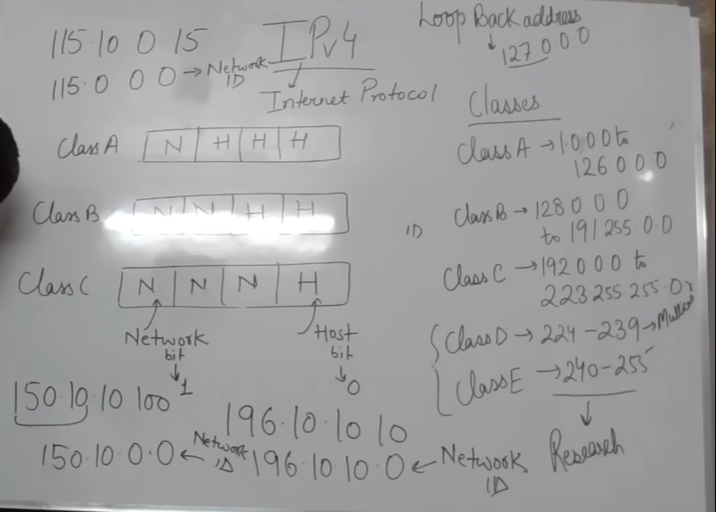

**how to find subnetmask**
---

- agar hamra ip hai `115.10.10.20` tou is **Class A** ho gi class A mein phla octet network ka hota hai baqi host ka tou **115 8 bar 11111111** mein change ho jaye ga or baqi 3 host wlay octet har **octet 8 bar 00000000** mein change ho jaye ga tou jo **11111111** jo hoga wo 255 mein or baqi 0 0 mein hi change hon ga subnetmask `255.0.0.0` ban jaye ga.

- aik or example agr hum ip likhty hein `160.10.20.10` tou is ki class b ho gi or is class mein network ko phly 2 octet mily hoty hein or host ko bad waly 2 tou jo network wala octet hai wo 8 bar 1 mein change ho jaye ga or host wala 8 bar 0 mein tou tou 1 waala part 255 mein or 0 wala 0 mein hi tou iska  **subnetmask** bny ga `255.255.0.0` .
- class b mein koooi b ip likhy ga subnetmask uska yhi aye ga.
- **CLASS A** ko **8 bit** **network** ka liye **reserved** hoty hai
- **CLASS B** ka liye **16 bit network reserved** hoty hain 
- **class c** ka liye **24 bit network ka liye reserved** hoty hain

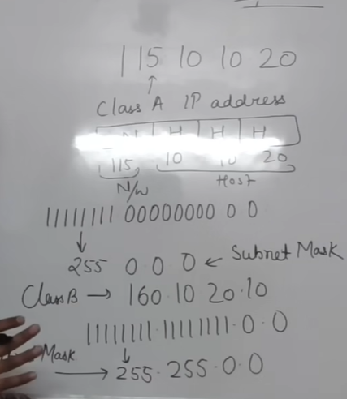

**how to convert ip address into binary form**
---

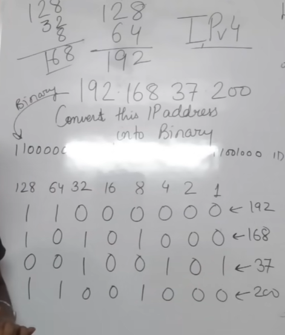

imagine humary pas **IP ADDRESS** hai `192.168.37.200` humary pas 4 octet hein har octet mein 8 bits hoty agr 8 bits ko 1 kar dein tou maximum 255 value aye thy is sa ziada nai a skty hein jinhy hum likhy ga **128 64 32 16 8 4 2 1** ab humy numbers ko ab hum na shkna hai ka 192 kin 2 values ko add krny sa bny gi jesy 192 bny gi 128 + 64 tou in do numbers ko 1 kar dein ga  baqi ko zero tou address bny ga  1 1 0 0 0 0 0 0 esy hi baqi numbers ko bi 200 bny ga 128 + 64 + 8 in ko 1 kar dein ga baqi ko zero tou binary from mein jo iska address bny ga wo ya hai `11000000.10101000.00100101.11001000` ya ip ki binary form hai

**PRIVATE IP**
---

- private ip ko purchase nai krna prta ya lan network mein use hoty

- agr humy lab ka andr 50 computer ko connect krwana hai tou hum private ip ka use kry ga
- private ip lan ka liye hi bnai gai hai ka agr humy 10 20 50 200 devices connect krwani hai.
- inhy hum internet pa nai la ka ja skty.nat ka through.
- **Class A** mein `10.0.0.0` ya private ip ka liye reserve hai
- **Class B** mein `172.16.x.x` sa la ka `172.31.x.x` tak ya private ka liye reserved hai
- **Class C** mein `192.0.0.0` ki pory range private ip reserved hai.

***PUBLIC IP PURCHASE Krny Parti hai PRIVATE IP purchase na krny prty***

**BROADCAST ID**
---
- Suppose aik ip hai `150.10.20.30` is mein phly ka 2 octet network ka liye reservd hein network id likhny ka liye phly 2 octet wesy hi baqi dono zero like `150.10.0.0` ya Hai **NETWORK ID** or broadcast ka liye simplly jo sth zero hein inhy maximum kaar dein like `150.10.255.255` tou ya **BROADCAST ID** hai apki.

**NO OF USER WE CAN ADD IN NETWORK**
--
- agr hum check krna chaye ka hum network mein kitny user add kar skty hein tou chk kry kitny no of host us class mein hein class b mein 2 octet host ka hoty hein aik octet mein 8 bit hoty hein tou ap aik network mein chk kar skty hein 2 ki power host bits jitni hien da dein or 2 sa minus kar dein `2**16 - 2 = 65534` itny devices ap connect kar ksty hein.

- useable ip pochy ga tou hum -2 kry ga wrna nai kiun ka jo phla ip hota hai wo hota hia **network id** or last ip hota hai  wo **broadcast id** hota hai. 
- network id ya btata hai ka device kis network par hai 
- 0 or 127 theoratically Class A ka part hi hai

#  LECTURE 10 

**IPv4 HEADER**
---
 
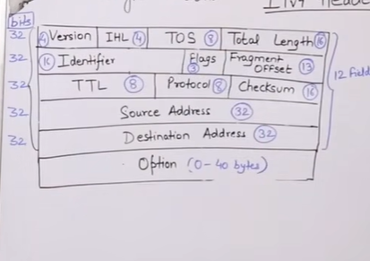

- IPv4 ka header  ki 12 fields hoty hein 

- ya 20 bytes fixed ya minimum value hai ya 60 bytes tak expand ho skta hai.
- agr hum koi chz online order krty hein tou us pa jo note name, to, from etc  hota hai wo header hi hota hai jis pa nam kha sa arha hai kha jana hai or bhut sary chezzy hoty hein.
- data ko hum networking mein packet bolty hein
- ya data jab transfer ho rha hota hai tou isky  agy lga howa hota hai data sa phly ya jaye ga
- ya information left to right phir bottom es tariqy sa flow krty hai
- har aik row 32 bits ya keh skty hein ka 4 bytes ki hoty hai 
- 1. **VERSION** sab sa phly version binary form mein transfer hoga like agar IPv4 hai tou 0100 ya chz btaye gi kon sa version transfer ho rha hai
- agar 0110 ho tou ya show kar rhy hai ka IPv6 hai.
- 2. **IHL(internet header length)** header length ya btata hai ka pa apko header kitny bites ka hai . header ko hum alg kr dein ga or baqi information rkh lein ga
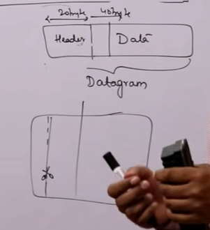

- header tou 20 sa 60 bytes tak ka hota hai lkin baqi information jo header ka pechy hai ya 65536 bytes ki hoty hai.

- jo b value transfer hoka aye gi usy 4 sa multiply kar dein tou **IHL**  a jaty hai.
- 3. **TOS(type of service)** ya btata hai ka data ko kis trha ki service chyie low delay ya high throughout mtlb ka data ko jldi phuchana hai ya aik time mein ziada data transfer krna hai.
-  4. **TOTAL LENGTH** mtlb ka pora data/packet ki kitny length hai
-  5. **IDENTIFIER** Mtlb ka jab data/packet ko choty choty fragment mein devide kar deta hai or aik identity deta hai batata hai ka ya mery hi sth hein phir usy transfer hony ka bad ikhta kar deta 
- 6. **FLAGS** ya btataa hai ka data ko fragment mein devide hona hai ya nai 
- 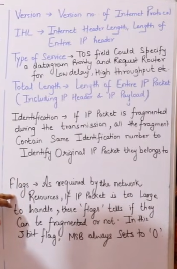
- 7. **FRAGMENT OFFSET** is mein packet ko or packeet mein devide kia jata hai tou ya locaation btaye ga ka ya jo packet devide hovy hein inki arrangement kia hai.pory packet ki aarrangement identifier krta hai.
- 8. **TTL(time to live)** ya source sa destination ka darmian router ki limit set kar deta hai ka usually 2**8 ya 256 router bnty hein agr is range mein b  data destination tak na phunchy tou discard ho jaye.
  -  ya looping ko manage krta hai sometime router aps mein loop bn LETY HIEN   ya range isy liye set ki jaty hain ka agr range mein data na ohunchy tou discard ho jaye.
- 9. **PROTOCOL** mein ya pata chlta hia ka is mein konsy protocol use hongy TCP ya UDP .
- 10. **CHECKSUM** agr data ka sth kuch kia giaa ho tou checksum isy discard kar da ga phir  isy retransmit krna pry ga
- 11. **SOURCE ADDRESS**
- 12. **DESTINATION ADDRESS**

# LECTURE 11

**SUBNETTING**
---
 
- humary pas IPv4 bhut hi limited thy is ko efficiently use krny ka 3 tariqy thy
  - 1. **PRIVATE IPs**(**class A** mein **10.0.0.0** ya private ip ka liye reserved hai  **class b** **172.16.0.0 to 172.31.0.0** **class C** mein **192.168.0.0 to 192.168.255.255** )
  - 2. **IPv6**s
  - 3. **subnetting**

**Subnetting ka mtlb kia hia**

- **subnetting ka mtlb hai network within network/logically devision of network**.

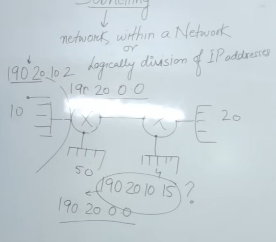

- 2 same network id router ka 2 interface pa nai ho skty 

- router ka har interface pa aik alg network hony chyie
- agar ip ka sth Class A mein /8 or Class B mein /16 or class C mein /24 likha hai tou is ka mtlb hai is mein abhy subnetting nai hoi.

# LECTURE 12

**SUBNETTING PART 2**
---

- suppose ma na **Class C** ka ip 197.10.10.0 kharid lia is ka **subnet by default /24**  ho ga .

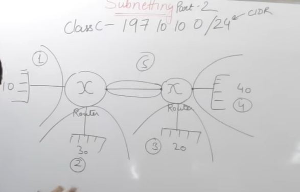

**step for giving ip in same network but different department**
---

- **1 ste**p mein jo network dia gia hai wo likhy ga 197.10.10.0 is mein phly ka 3 octet network id ka liye reserved hoty hein or jo host wala octet hai isy binary mein cinvert kryein ga.

- **2 part** mein host part ko binary mein convert kryein `197.10.10.00000000` 
- **3 part** mein hum dhky ga ka pory network mein dhky ga ka kis jaga pa maximun value chyie pir usy likhy gy **2*n-2 >= 40** 
- subnetting ka 2 tariqy hein
  - 1. according to host requirement 
  - 2. according to network requirement
- hum according to hodt requirement kar rhy hein.
- 2 ko multiply krna hai 1 sa la ka jha tak is ki value 40 ka equal ya greater than tak aye.
- jo b value condition ko satisfy kry gi hum wo value likh lein ga jesy **n = 6** ya 64 ho gi.
- **4 step** mein hum uper wala ip likh lety hein like `197.10.10.00000000` hum right side sa left mein 6 bit ko rok lein ga host ka liye baqi network ko borrow kar dein ga `197.10.10.11000000` ab iski decimal value `197.10.10.192` bny gi yhi **subnetting hai ka host ka bit network ko da diiye**. 
- **5 step** **subnet mask Class C** ka **by default 255.255.255.0** hota hai subnetting ka bad ya change ho kar hmary case meiin ya `255.255.255.192` ho jaye ga.
- **6 STEP** mein subnetting ka bad ip change ho ka aye ga `197.10.10.0/26`ya humary **subnet i'd** hai class C ka pass network ka 24 bit hoty tou is mein 2 bit hum na network id ko 2 or bit da diye tou ya 26 ho jayein ga.agr 24 ka ilawa kuch b aye 25 26 27 tou is ka mtlb hai is mein subnetting hoi hai.

**agr humy subnet bnany hein ya network into network**
---

- **according to network subnet banany ka liye jo n ki value ho gi hum right sa utny bits 1 kar dein ga**.

- agr humy usy network mei aik or network bnana hia mtlb ka subnet banana  hai tou phla subnetid 1 `197.10.10.0/26` is mein aik network hai 

- or aik or subnet2 bnana hai tou `197.10.10.64/26` is sa network ka andr aik or network ban jaye ga.
- aik or subnet3 banana hai tou subnetid become `197.10.10.128` this is this is the subnet3.
- aik or ban jaye ga like `197.10.10.192` ho ga
- or nai ban skta kiu ka is mein agr or devices contect kry ga tou ya 256 ho jaye ga joka possible nai hai. 
- subnet ka akry id is ka broadcast id ho ga.

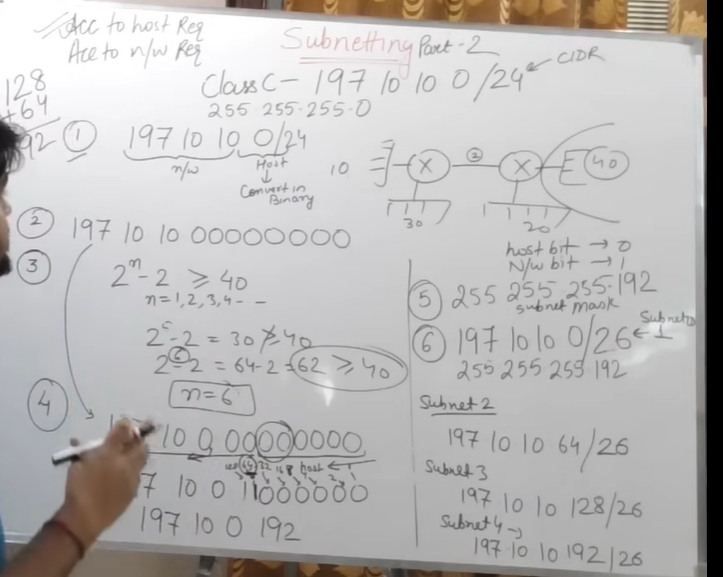

`197.10.10.182/26` is ki subnet id kia hia or iski broadcast id kia hai

- ya subnet 3 mein aye ga kiun ka subnet 3 128 sa shiru hota hia 192 pa end
- iski broadcast id subnet4 ks start sa phly waly i'd ho gi jo bny gi `197.10.10.191/26` ho gi.

# LECTURE 13

**subnetting of class A**
---

everything is same as i explain above

- ip that is given to us is `12.0.0.0`

- **subnetmask of class A** by default is `255.0.0.0` 
- after subnetting it will become `255.255.255.192`
- first subnet id is `12.0.0.0/26` is mein 26 bits network ka liye hein /26 is important it is **CIDR**(classless inter-domain routing) .
- is ki broadcast id ho gi `12.0.0.63/26` 

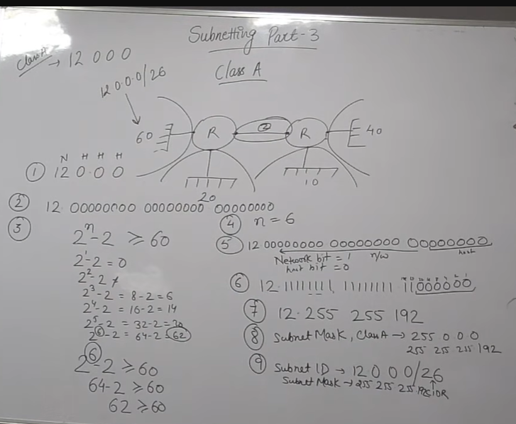

**new subnet kesy bny ga**
---

- left sa dhky ga jo binary value phly aye gi us ki decimal value add krny sa new subnet ban jaye ga
- 2nd subnet ma 64 bits add krny ka bad new subnet id aye gi `12.0.0.64/26` iski broadcast id  `12.0.0.127/26` ho gi.
- 3rd subnet `12.0.0.128/26` ho gi 
- 4rth subnet id `12.0.0.192/26` .
- 5th subnet mein id  ban jaye `12.0.1.0/26` kiu ka 192 mein 64 add kry tou 256 ho jaye ga jo ka possible nai hai ya agky octet mein 1 mein cahnge ho jaye ga.
- jo last subnet bny ga wo ho ga `12.255.255.192` .or second last is mein sa 64 - kar do.

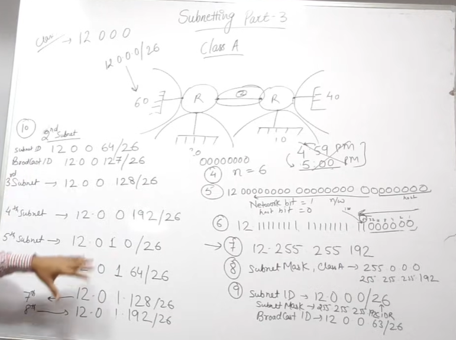

**for little greater network than before**
---
- procedure is same as above 

- network jis mein 1024 devices connect hein hum wohi formula lgaye ga **2**n - 2 >= 1024**  
- **ya step important hai** kiun ka jab hum 2**10 kry ga tou 1024 aye ga ya corrct nai kiun ka is mein sa -2 hony hein 
- **n = 11** correct answer hai 
- hum ip ko binary mein likkhny ka bad  left sa ll bits host ka liye reserved kry ga  baqi network ko borrow kar dein ga.
- tou **subnetmask** ip bny ga `12.255.248.0/21` ya bny ga
- **1st subnet id**  `12.0.0.0/21`
- **2nd subnet id** `12.0.8.0/21` is mein value 3 octet mein add kry ga 
- **3rd subnet id** `12.0.16.0/21`
- **broadcast id** of first subnet is `12.0.7.255/26` 

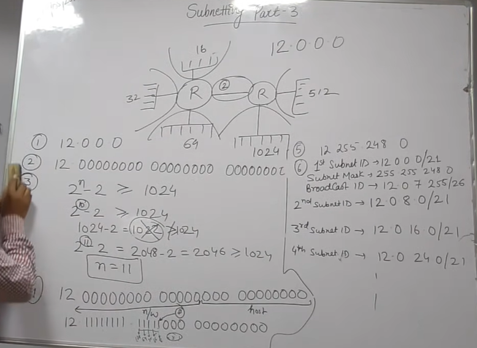

`200.10.20.10/26` is mein kesy pata lgaia ja skta hia ka kitny computer add kuye ja skty hein.

- total bits 32 hoty hein class c mein 24 network reserved hty hein tou hum dhk skty hein ka 32-26 jo bchy ga usy 2 ki  power bna dein or un mein sa  2 minus kar dein jo ayein ga utny computer hum network mein add kar skyt hein.  

- generally router ka bech `200.10.20.40/30` di jata hai is mein ya is liye ka baqi ip waste na hun router ka bech  sirf 2 ips hi chyie.

# LECTURE 14

**SUBNETTING ACCORDING TO NETWORK**
---

sawal hai consider kryein ip 157.110.88.0 humy 30 subnet chyie jo 64 jha 64 computer connect hon

- jab b sawal aye ka humy 30 subnet bnany hein aik network mein tab hum **according to network** subnetting kry ga.
- or jab sawal kia jaye ka ya  network hai is mein 40 host chyie 50 host chyie phir hum **according to the host** subnetting kry ga.

- sab sa phly ip `157.110.88.0` 

- ya class b ka ip hai 
- is mein phly ka 2 octet network ka liye ir baqi ka 2 octet host ka liye reserved hein
- is ki network id ho gi `157.88.0.0` 
- host ko binary mein convert kia 
- **n** ki value dhkny ka liye agr subnet bnany hun tou formula hai 2**n >= 30.
- hum ip likhy ga `157.88.00000000.00000000` tou left sa right ki trf 5 bits network ka liye reserved kar dein ga. 
- is ka subnetid ban jaye ga `157.88.248.0`.
- subnet mask `255.255.248.0`
- 1st subnet `157.110.0.0/21`
- hum na 3rd octet mein jo value add krny hia usy find krny ka tariqy ya hai ka jo value b phly ip mein host waly part mein 1 ki ho gi wo add kry jaye ga.
- iska broadcast id `157.10.7.255/21` ho ga.
- 2nd subnet `157.110.8.0/21` jis octet mein value change ho gi usy octet mein add krna hai.
- iska broadcast ip `157.10.15.255/21` ho ga.
- 3rd subnet `157.110.16.0/21` ho ga.
- last subnet is meiin jo b ip `157.110.248.0` ho ga.wohi last subnet hoga.
- usable subnet id check krny ka liye wesy hi formula lgai 2**n -2 >= 30 tou usable subnet ajaeyin ga.
- to check no.of host hum jo host number heinn inhy par formula lgai ga 2**11-2   jo answer aye ga ya number of host per subnet hon ga.

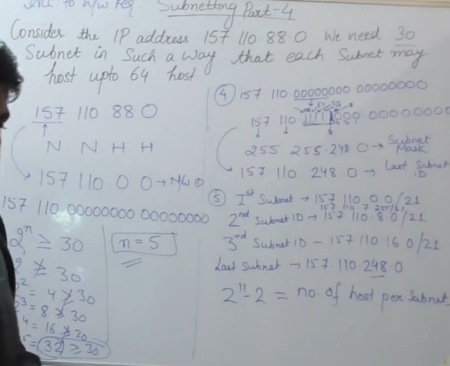

**now suppose we requied 130 subnet**
---

- sab sa phly ip likhy ga Class A ka

- phir usy binary mein likh lein ga
- 3ra step mein hum formula lgai ga 2**n >= 130
- n ki value 8 aye gi
- subnet mask is `255.255.0.0` .
- iska first subnet id `10.0.0.0/16` ya bni gi.
- dusra subnet id `10.1.0.0/16` is mein esy hi aik aik second octet add krty jayein ga tou subnet ban jaia kry ga.
- is ka broadcast id `10.1.255.255` hog
- 2nd subnet `10.2.0.0/16` hoga iski broadcast id hai `10.2.255.255/16` .

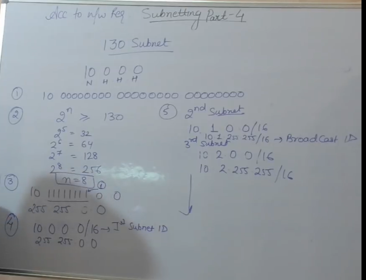

suppose apky pas ip hai `192.168.15.20/28` iski subnet id btaye or ya kis subnet ka part hai

- class c ka liye default subnet 24 hota hai lkin yha pa 28  hai mtlb ka 4 octet sa 4 bit b isy diye gye hein

- 28 mtlb ka bianry form mein kry ga tou 4 octet ka 4 bits hmary pas hon ga left ki trf sa  phly bit ka 16 hoga  tou 16 add krty jaye ga like `192.168.15.0/28` ya phla subnet id
- 2sry subnet id `192.168.15.16/28` ho gi.
- add krty jayein ga tou is ka subnetid aye gi `192.168.15.112` iski broadcast id `192.168.15.127/28` ho gi.
- hum subnet ko count kry ga jis value mein iski range aye gi bta dein ga ka ya is subnet ka part hai
- 

# LECTURE 15

**VLSM(variable length subnet mask)**
---

- **subnetting** mein b **ip waste** hoty hein tou agr us wastage sa b bchna hai tou hum **VLSM** ka istemal kry ga.

- hum 2 router use krty hein or un sa network create kar lety hein.
- ip **class c** ka mila howa hai `197.10.10.0` ip hai.

 **1st step**
- 
-  phla ip lety hein
-  ip ka network octet wesy hi rkhty hein or host octet ko binary mein change kar deinga like `197.10.10.00000000` . 
-  iska subnet mask `255.255.255.0` ho gi
 
**2nd step**
---

- formula lgaen ga 2**n >= 30 ka kiun ka ya networks jo hum na bnai hein maximum devices network mein 30 hein

- **n = 5** ya btaa rha hai ka jo host ka liye number of bits chyie

**3rd step**
---

- `197.10.10.00000000` is mein 5 bits chor kar 4 octet mein baqi ka bits ko 1 kar dein like `197.10.10.11100000` 

- kiun ka **class C** mein 3 octet network ka baqi ka aik octet host ka hota hai
- is ki decimal value `197.10.10.224` bny  gi

**4th Step**
---

- subnet1 bny ga `197.10.10.0/27` phla jo b hota hai wo uska subnet id hota hai . or phla subnet ip subnet id hota hai.

- subnet bny ga `197.10.10.31/27` ya is ki broadcast id b hai kiun ka subnet ka last ip broadcast ip hota hai
- ya hamara aik subnet hai

- agr hum 32 add krty jaty tou subnetting krty tou ip waste hoty isy bchany ka liye hum VLSM use kry ga.

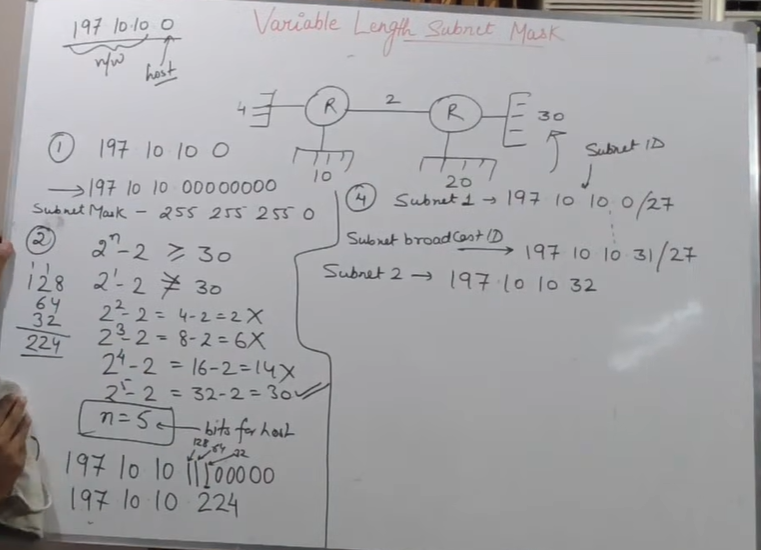

**5 Step** 
---

- naia subnet ko ip deny ka liye hum is sa kam ip wala network lein ga
  
- is mein dubara formula lgar ga 2**n - 2 >= 20 is mein value aye gi **n = 5**
- 5 host ka bits chor ka baqi ko 1 kar dein.
- ya steps sary dubara ho ga
- **subnet 2** bny ga `197.10.10.32/27` ya is ki SUBNET ID 
- `197.10.10.63/27` ya iski broad cast id hai 

agly network mein subnet krny ka liye
--

- jo total devices hein unko formula ka smny rkh ka process kry 

- n ki value 4 aye hai 
- jo value aye utny host bit ko reserved kar dein or  baqi ko network ko borrow kar dein .
- is ka subnetmask decimal mein aye ga `197.10.10.240` 
- **subnet3** ip `197.10.10.64/28` ya ip **subnet id** ho ga 
- ip `197.10.10.79/28` iska broadcast id b hai.

- **subnet4** mein 4 devices connect krny hainn
- **n=3**
- ip ka network octet wesy hi host octet ko binary mein convert kar dein 
- host octet mein left sa 3 bit ko host ka liye reserved kia kiun ka is mein n ki value 3 ayi hai or baqi ka bits network ko borrow kar dein ga.
- ip ban jaye ga `197.10.10.248` decimal mein subnet mask iska subnet mask `255.255.255.248`.

- **subnet4** ho jaye ga `197.10.10.80/29` ya is ka subnet id hai
- is ka broadcast id `197.10.10.87/29` .
- in dono ka bech jo ips hain wo useable hain
- **subnet5** n=2 
- 2 host ka liye baqi 6 network ka liye
- `197.10.10.252` ya is ki subnetmask decimal mein hai.
- iska **subnet id** `197.10.10.88/30`
- iska **broadcast id** `197.10.10.91/30` .
- in dono mein jo hein 89 or 90 ya useable hein.
  
# LECTURE 16

**SUBNET SUPERNETTING/prefix aggregation/route aggregation**
---

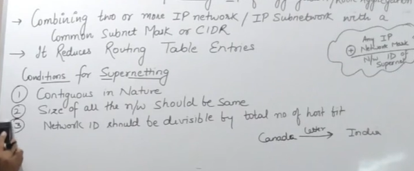

**2 ya 2 sa ziada ip network ya ip subnetwork ko combine krna jinka subnetmask ya CIDR aik ho .**
- ya routing table ki entries ko kam krta hai.

example; agr hum na aik hi router mein different network bnai hovy hein or har network  ka different ip address hai in sab ko combine kar ka aik hi ip address  mein change krna ka dusry network ko koi kam hai tou wo sirf us ip address ko access kry .

- iski example esy la skty hain ka agr hum na kisy foreign network country sa koi parcel pakistan bhjna hai tou wo ya nai dhky ga ka ya islamabad jaye ga y lhr isy trha aik router dusry router mein koi request bhjy ga tou wo ya nai dhky ga ka ya kha jany hai blky ya sirf router ka ip address likhy ga.

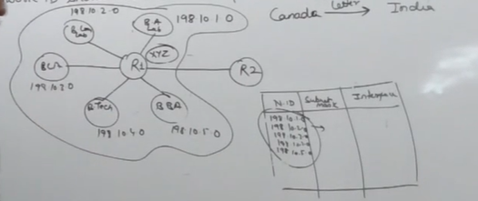

**how can we do supernetting**
---

- agr humy 500 computer lab mein lgany hien tou hum class c sa nai lga skty humy class b ka ip lena pry ga lin is ka aik or tariqa b hai hum 2 class c ka ip lein ga inko supernetting sa combine kar dein ga.

suppose we have 2 IPs

**first step**

- phla ip `198.10.20.0/24` or dusra ip `198.10.21.0/24`

**2 step**

- hum inhy binary form mein convert kry ga like phla ip ko `11000110.00001010.00010100.00000000` dusry ip ki binary form `11000110.00001010.00010101.00000000` .

**3 step**

- in dono ips ka **AND operation** krna hai.

- and operation mein agr dono values  1 hein tou 1 aye ga nai tou zero like (1+1 = 1), (1+0 = 0)
- and operation ka bad jo ip ki binary form aye gi wo hai ya `11000110.00001010.00010100.00000000` tou jha sa ap ka ip same rhy ga wo network part hoga or jha sa ip ki binary form change hogi wo host part hojaye ga.
- 23 bits network ka pas hein or 9 bits host ka pas hein

- inhy jab decimal mein change kar ky likhy ga tou jo value aye gi wo **supernet id** hogi `198.10.20.0/23` .

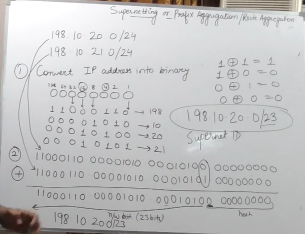

**agr ziada ip diye gaye hein tou phr kia hoga**
---

- suppose we have 6 ips 
- inhy binary mein convert kia 
- phir in pa **And operation** lga dia.
- yha pa 11 bits host ka liye or 21 bits network ka hain.
- inka supernet id hoga `198.10.96.0/21` 

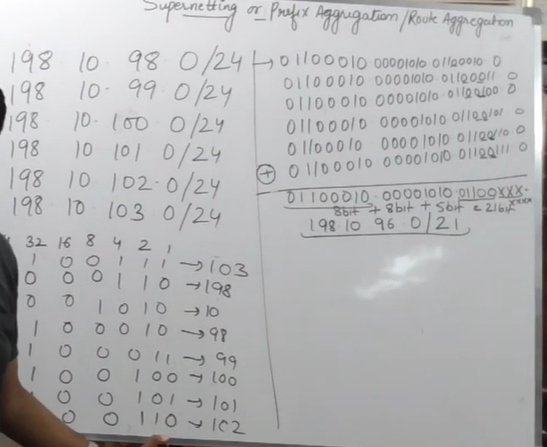

# LECTURE 17 
**DNS(domain name system)**
---

- agar hum **www.google.com** likhy ga tou computer isy nai smjhy ga kiun ka **computer logical addressing** smjhta hai logical addressing hmra **ip address** hota hai.

- **www.google.com** ya aik **domain** hai jo humy kharidni prty hai is sa hum google ka server phunch jaye ga.

- agr humy bola jaye ka google ka ip type kry tou ya muskil ho jaye ga humy nam easy sa yaad rhty hein.

**important points**
---

- dns host name ko ip address main change kar ka deny ki service hai

- ya application layer pa kam krty hein
- 1990 mein phly hum domains ko .txt file mein saved kar ka rkhty thy.
- **6 top level domains are;**
    - .com
    - .org
    - .mil
    - .net
    - .edu
- ya **reverse or forward DNS** dono kam kar skta hai like agr ip dety hein or khty hein ka mujhy web ka nam btao or web ka nam likhty hein or khty hein ka iska ip btao.
- highly targeted for hacking purpose.

- it uses both tcp port 53 or udp port 53 according to requirement of user.
- abhy tak dns ka 13 root name servers  avaiable hain. **A - M** tak.
- 2 tariqy sa hum hostname ko ip mein change kar skty hein 
  - phla hai hum router k zariye domain change ker dein.
  - 2sra ya hai ka hum koi b device dns server  bna dein.

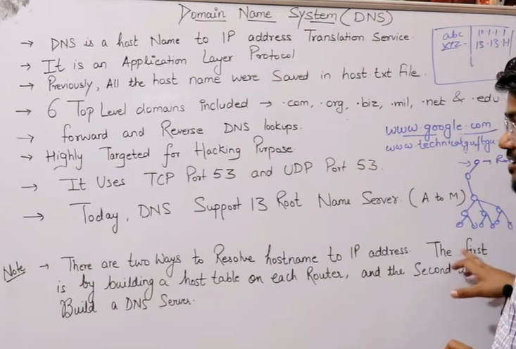

Domain 3 trha ka hoty hein

1. **Generic Domain**
    - .mil
    - .com
    - .edu
    - .net
    - .org
2. **Country Domain**
    - .us
    - .uk
    - .pk
3. **Inverse Domain** hum ip sa nam find karty hein.

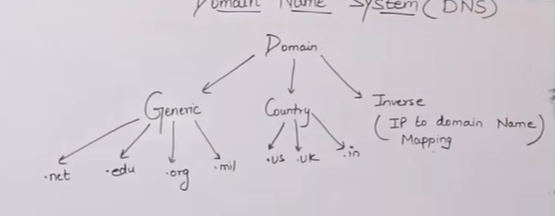

**NAMESPACE**
---

**domain mein nam rkhny ka tariqa** 

ya 2 trha ka hein

1. **FLAT NAME SPACE**

- hum isy is tariqy sa smjh skty hein ka jesy aik company bnai jis mein hum na aik user add kia **vasay admin** ka nam sa phir aik or nam add kia **sohail IT** ka nam sa phir aik or nam add kia **riya marketing** ka nam sa.
- agar esy koi 500 user add kiye tou kuch b smjh nai ana cheezy mixup ho jayein gi
- can't be used in large system

2. **HIREACHICAL NAME SPACE**

-  is mein kam ho ga jesy aik company hai 
-  company mein hum na 3 areas mein devide kar dia like aik admin ka blockk aik mein marketing or aik mein IT ka bndy
-  jab b kisy bndy tak access chyie tou us ka nam jis field mein hai or company name. 

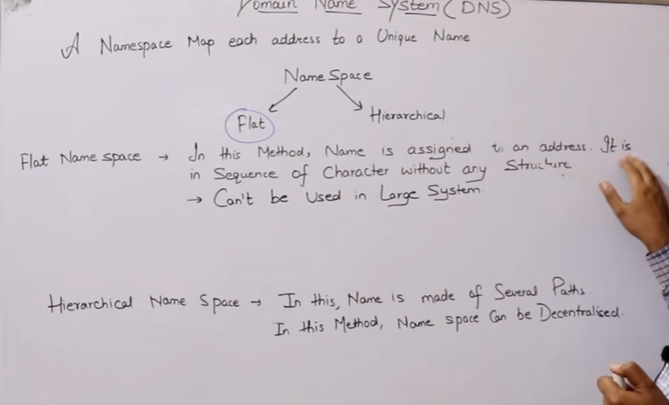

**hireachy of name server**
---

1. **Root Name Server**

- root server sab sa top level pa hota hai 

- hum generally is pa kbhy b nai jaty 
- agar hum phly bar khy kuch access kar rhy hein tou phly cache mein dhky ga fer sth waly  router mein phir b na mila phir root mein jaye ga.
- root name server par tab jaty hein jab domain dns pa resolve nai ho paty.
- agr root name server par koi request aye ya domain kha par pry hai iska ip address kia hai.tou ya top level pa request bhj da ga. mtlb ka agr reqest hai **www.facebook.com** ya request **.com** ki hai tou ya **top level** pa bhj da ga.
- top level ya request **authoritative lvl** pa bhj da ga kiun ka **www.** ki info idher hoty hai.
-  ya actually request resolve kar ka dety hian.
- phir **authoritative lvl** resolve karky **top lvl** ko da ga **top lvl** root ko or **root name server isp ko** provide krta hai ka ya hai is ka ip address. 

it is called **recursive method** kiun ka is mein root name server end tak jora rhta hai or resolve kar ka deta hai.

**Authoritative name server** 

- agar humy **ccna.tg.in** mein jana hai tou ya request root ka pas jaye gi.
  
- root name server ya request top level ko da ga
- top level ya **authoritative lvl** table bny hon gy jha sa ya  ip provide kry ga.

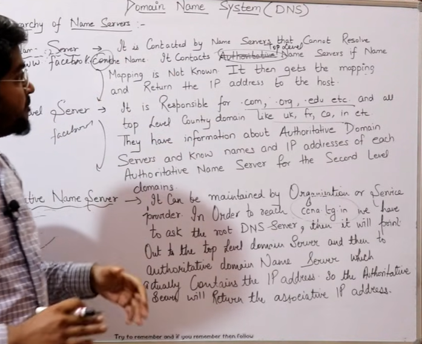

**actual method for resolving ip**
---

-  this is **iterative method**
-  we have **two method** for **resolving dns query**  .
   -  1. **iterative method**
   -  2. **recursive method**

**host/user**

- agr hum chahty hein ka **www.ccna.tg.in** resolve kar ka is ka ip chkk krna hai tou

- ya phly request **dns** ka pas jaye gi agar is ka pas **ip**  nai hai tou ya cache ka pas jaye gi agr cache sa b 48 hours ho gye remove ho gai tou phir ya **name server** sa **root name server** ka pas jaye gi.
- **root name server** dhka ga ka is ka end mein **generic domain** hai ya **country domain** hai phir ya wapis **name server** ko bta da ga ka is ka correct ip tou nai pata lkin ya pata hi ka is ka end mein jo domain hai wo yha pa pry hoi hai .
- **name server** wo domain us sa nechy name address ko da ga  or btaye ga ka ya domain mujhy khabar mily hai ap ka pas hai tou ya btaaye ga  sary ka tou nai pata lkin .tg.in udhr pry hoi hai.
- **name server**  phir wo reqest us sa b nechy name server ko bhjy ga tou ya ip chk kar ky us ka pas howa tou da da ga nai tou apny ass pas mein chk kar ka ip provide kar da ga
- wo ip **name server** ka pas jaye ga name server isy host ko da ga host usy router ko da ga then wo web open ho jaye gi.

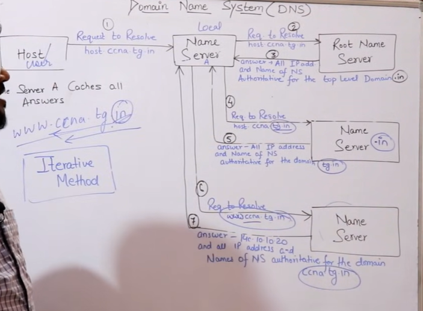

- ya tha **iterative method** is mein ya apas mein **interconnect** nai hein .

- **recursive method** mein ya apas mein **interconnect** hoty hein

**difference between fully qualified domain name or partially qualified domain name**
---

- domain .root isy dot sa represent kia jata hai .

- root ka bad **region** a jata hai jis mein **.in , .com , .uk , .org , .mil** a jata hai
- is ka bad **google ki domain** la lein ap.
- google sa ap 2 or department bna dein aik xyz or aik abc

- **FULLY QUALIFIED DOMAIN NAME** root par ja ka kthm hota hai .

- **PARTIALLY QUALIFIED DOMAIN NAME** mein like www.google.com ya root  pa ja ka kthm nai hota

- agr hum .in. sa shiru or kthm krty hein  tou b ya **fully qualified domain name** nahi hoga.

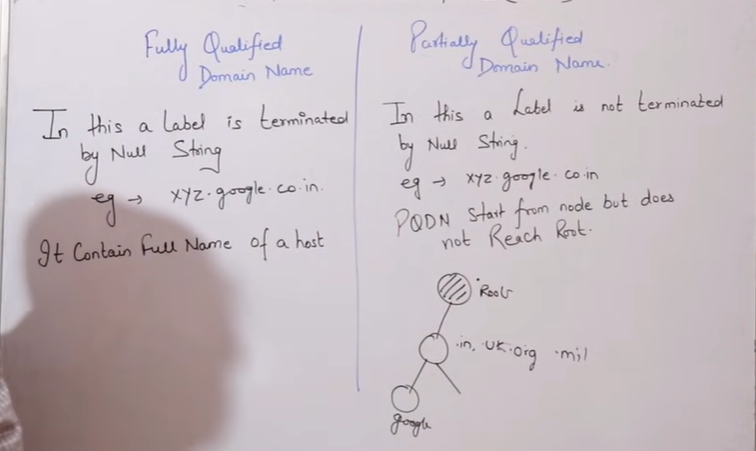

# LECTURE 18
**DHCP(Dynamic Host Configuration Protocol)**
---

**host/user ko dynamically/automatticaly ip provide krna so that they can communicate on the network.**

- **DHCP** public IP b deta hai or private IP b deta hai but ziada tar ya **private IP**  provide krta hai

- generally ya LAN mein use hota hai
- jab inhy internet par jana hota hai tou ya **NET**  ka zariye public ip mein convert ho jata hia.

**suppose hum na switch sa network bnaia howa hai jis mein 6, 7 devices connect hein ya apas ma communicate ip ka through krty hein ya ip inhy automatically **DHCP SERVER** provide krwata hai.** 

- agr aik chota network hai tou hum inhy manually b alg alg ip da skty hein.

**ip kesy dety hein**
---

- kisy b laptop mein right side pa ja ka network setting pa click krein ga tou wha pa tcp ip ka option hoga generally hum automatic configure kar dety hein tou wo DHCP server sa configure kar rhha hota hai. 

- hum manual configure b kar skty hein

- hum router ko b DHCP server ki trha configure krwa skty hein.

points about **DHCP SERVER** 
---

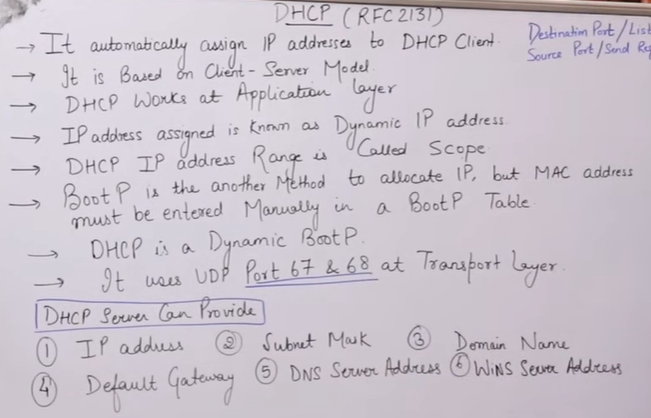

- **DHCP** automatically network mein devices ko ip assign kar deta hai

- it is **client server model**. is mein aik seerver ho ga ya aik sa ziada b ho skty hein ya service provide krty hein.
- jo ip address assign kia jata hai wo dynamic ip address hota mtlb ka temporary permanent nai hota jo b ip dia jaye ga 10 mint 15 mint 30 ghnta wo time pora hony ka bad la lia jata hai agar user usy dubara renew nai krta tou.
- DHCP server ko user aik range btata hai ka es range mein reh ka apna ip deny hein isy method ko scope khty hein.
- BootP(bootstrap) ya DHCP sa phly dynamicaly ip assign krny ka method tha is mein jab b humy kisy b device ko ip assign krna hota thy tou us ka  mac address manually uska system mein add krna prta tha
- Ya UDP(connection less) port 67&68 ka istemal krty hein TCP(connection oriented) port hoty hein.ya transport layer pa kam krta hai.

**DORA(discover operate request acknowledge) PROCESS**
---

- DHCP dora process sa hi IP assign karta hai.

1. **DISCOVER**

   -  suppose hum na client computer network ma new lgaia hai usy abhy IP assign nai howa or aik DHCP server hai computer braodcast kry ga apna mac address sai hi bhjy ga lkin jo **destination mac address wo FF:FF:FF:FF:FF:FF** 
   -  destination IP b broadcast kry ga like **255.255.255.255** kiu ka isy nai pata network ma DHCP seRver kha pa hai 
   -  baqi ka bndy isy dekh  kar dein ga ya dhk ka is ka destination mac address mein broadcastmac hai. ka isy abhy ip assign nai howa ya DHCP sever dhund rha hai .
   -  **client device** hai wo hamesha **port 68** sa request bhjta hai.
   -  or **DHCP server** **port 67** ka istemal kry ga bhjny ka liye.   

2. **OFFER**
    - **DHCP SERVER** dhky ga ka is na request mein ip nai lgaia howa ya bnda tou ip mang rha hai
    - DHCP server ip offer kry ga like `192.168.1.4` ya ip mein ap ko da skta hon jo avaible hai

3. **REQUEST**

    - ya request kry ga thk hai da dein mujhy mein ready hun
    - ya is message ko b broadcast kry ga 
    - agr ya chta tou unicast b kar skta tha
    - lkin network mein 2 sa ziada **DHCP** server ho skty ho skta hai unho na b ip offer kia ho. ya jis DHCP server sa phly request aye gi us ka ip message ka sth likh kar broadcast kar da ga unhy b pata chal jaye ga ka bndy ko ip mil gia hai.

4. **ACKNOWLEDGE**

    - DHCP server bta da ga ka ok mujhy paata chal gia hai ka apna mera ip accept kr lia hai
    - tou baqi server b smjh jaye gi ka isy ip mil gia hai. 
- jab **DHCP server packet** bhjy ga us mein aik **broadcast flag** hota hai **BCF** agar ya 0 hoga tou ya unicast kry ga agar ya 1 hai tou ya multicast kry ga
- it **depend on BCF 0 or 1**

- agar chota network lga hai tou ya broad cast kar da ga 
- lkin agr network mein router lgy hovy router ka zariye wo message khy or jana hai  tou router broadcast nessage ko block kar da ga. is wja sa DHCP server usy unicast kaar ky us ky ip ka zariye usy destination tak phucha da  ga.
- ya acknowledgement kry ga ka mana apny table mein apka mac address ko ya ip da dia gia hai.
- **EXAMPLE :** Jo modem lga howa hai or hum wifi sa is sa connect hotu tou actually  ya  humy private ip  provide krta hai generally  `172` ki range main hoty hai tou ya DHCP server ki trha kam krta hai ya apna aik table b bna leta hai.

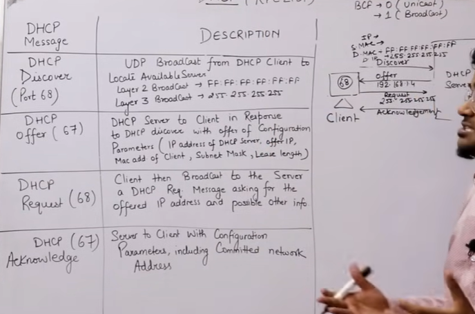

**DHCP SCOPE**
---

DHCP server ko aik range btaye jaty hai ka is range mein apny ip assign krny hein isy dhcp scope khty hein.

**superscope** :

aik hi server mein 3 4 ips ki range allocate kar dein super scope hota hai

**ADVANTAGES OF SUPERSCOPE**

- agr aik ip ki range kthm ho gai hai tou ya dusry ip sa range provide kry ga
- hum aik hi network mein 2 dhcp server lga skty hein
- agr hum apny client ko aik range sa dusry range mein move krwana chty hein tou b hum superscope ka ise kry ga. agr aik server down ho  jaye tou dusra ip provide kry ga.

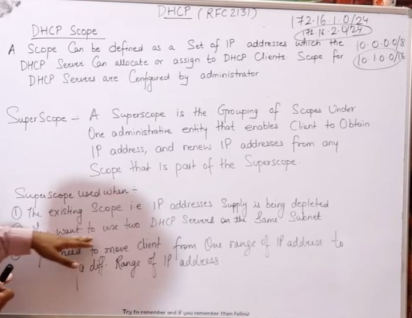

yha pa RFC 2131 bas wo documents hien jinki bina par dhcp server bna hai.

ADVANTAGES of DHCP server
---

- agr hum na chota network bnaia tou ip manually b assign kar skty hien lkin agr 500 ya 1000 computer ka network bnaia ho tou is mein kis computer ko konsa ip assign kia howa hia pata nai chlna agr yha pa hum na dhcp server lgaia howa hia tou hum easily dhk skty hein ka kis mac address ko konsa ip assign hai.
- agr manually ip assign krty hein tou ho skta hai hum aik ip ko 2 logo ko da dein ya is problem sa b humy bchata hia.

**hum choty network mein modem ko thory bary network mein router ko or us ka ilawa aik computer ko b DHCP server ki trha kam krwaty hein**

# LECTURE 19
**SMTP(simple mail transfer protocol)**
---

- SMTP mail ko **send** krny ka liye istemal kiya jata hai

- meil ko receive krny ka liye **IMAP or PoP3** protocol use hoty hein.
- ya **APPLICATION layer** pa kam krty hein 
- **SMTP TCP port 25** use krty hein
- gmail port no 465 use krta hai.
- it is a **push protocol**.
- smtp jo message bhjta hai wo **7 bit ASCII Format mein bhjta** hai.mtlb ka har basic character ko 7 bit binary form mein convert krta hai.

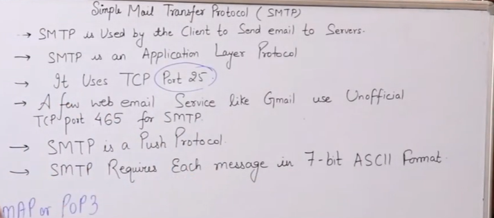

**SMTP COMMANDS**
---

- **HELO & EHLO** command server or client ka darmian aik session establish krty hein.agr hum 25 ka ilawa koi or port use krty hein toou hum EHLO command ka use kryein ga ya extension hai HELO ka.

- **MAIL FORM**  ya command btaty hai ka mail kha sa a rhy hai.
- **RCPT** receiver ki information dhk skty hein.
- **DATA** ab jo any wala hai wo data hai.
- **"."** bhjy ga tou pata lag jaye ga ka ab data end ho gia hai.
- **RSET** jab humy koi error aye ga tou hum rset ka istemal kry ga.
- **NOOP** is sa hum dhk skty hein ka receiver koi response b kar rha hai ya nai.
- **QUIT** connection  ko  terminate krny ka  liye

**MODEL OF SMTP SERVER**
---

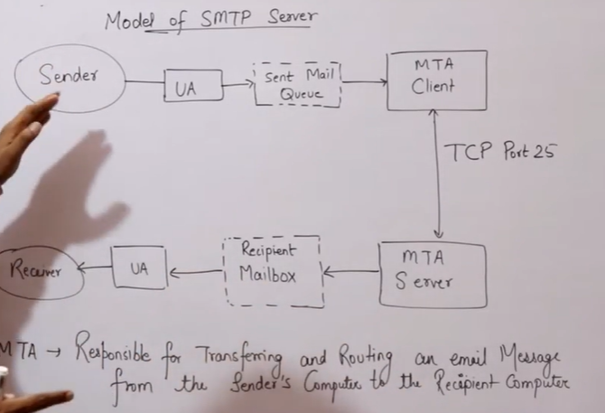 

- **UA(user agent)** hamra ua gmail hai ya outlook hai.hum kisy application/agent ka through mail send rkty hein.

- **sender mail QUEUE** ya us company ka jha b server hoga usky queue mein chly jaty hai.
- **MTA client** TCP 25 ko use karky sender sa information receiver **MTA server** tak phuncha da ga.
- **Recepient Mailbox** pa ya email receiver  ka inbox mein phunch jaye gi.yha par phunchty hi receiver ko acknowdlegement signal bhj da ga ka apki email phucnh gai.
  
Example of responces
---

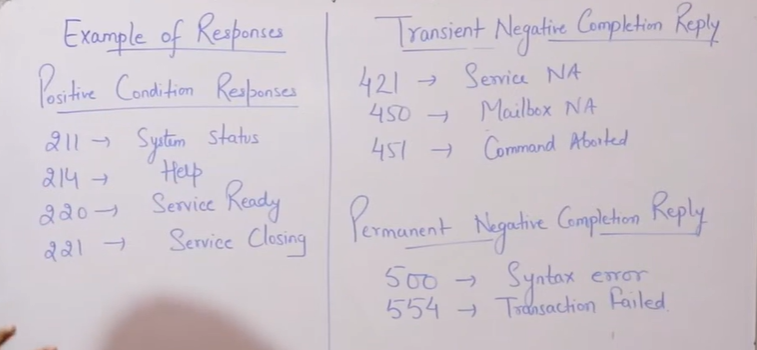

**MAIL TRANSFER PHASES**
---

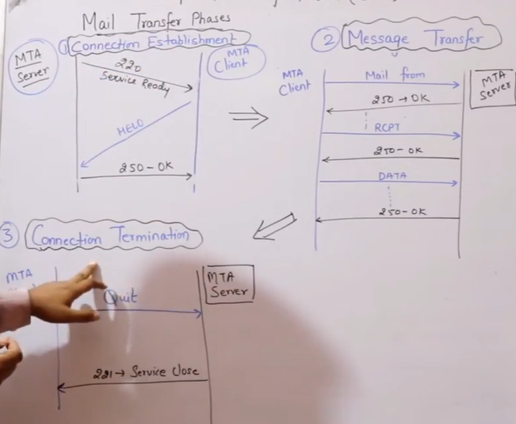

# LECTURE 20

**ARP(address resolution protocol)**
---

**jab humy logical address ka pata ho or physical address ka na pata ho tou hum physical address find krny ka liye ARP use krty hein.**

- ip address ki base pa mac address ka pata lgana .

- it is layer 2 protocol.
- hum jo chz resolve kar rhy hein wo layer 2 pa hai tou hum isy layer 2 ka protocol khy ga.
- ARP request is a broadcast.
- but ARP responce is unicast.
- ya sirf ipv4 mein use hota hia ipv6 mein nai hota.
- ya same network mein use hoty hai ya different network id ka liye generate nai hogi.

**type of arp**

1. normal arp
2. proxy arp
3. reverse arp
4. gratituos arp

**FORMAT OF ARP packet** 
---

-  **Hardware type** hum request kesy bhj rhy hain ethernet ka zariye ya wireless ya kisy or tariqy sa request bhj rhy hein.
  
-  **protocol type** mtlb ka ya kis version mein istemal hota hai yha pa ipv4 hi aye ga bs.
-  **hardware length** mein mac address aye ga ya **6 bytes** ka hota hai.
-  **protocol length** mein ip address ya normally **4 bytes** ka hota hai.
-  **operation** mein agr request ka liye 1 field mein ata hai or agr responce ho tou 2 field mein aye ga.
-  **sender hardware address** mein sender ka mac address a jaye ga 
-  **sender protocol address** mein sender ka ip address a jaaye ga.
-  **target hardware address** ya khali hoga kiiun ka mac humy find kry ga is mein sary octet zero mein hi likhy hon ga
-  **target protocol address** is mein receiver ka ip address likhy ga.

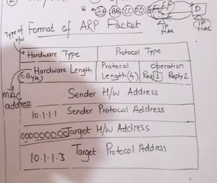

**ARP kia tariqy sa MAC ADDRESS KO resolve krta hai**
---

- suppose hum na aik switch sa 4 devices connect ki hoi hain switch aik network mein hi kam krta hai .

- switch aik CAM table maintain krta hai jis mein jo device connect hein unki ip ka correspond mac address save krta hai
- hmary pas aik new device aye hai jis ki network id tou same hi hogi lkin mac ka abhy ip ko b nai pata
- agr data packet ka sth source ip or soucre mac ka sth destination ip or destination mac send kry ga tou hi ya send hoga.
- suppose network mein c device ka mac address nai pata tou hum aik **ARP** **request** generate kry ga jis mein source ip or source mac or destination ka ip or destination ka mac mein broadcast mac `FF:FF:FF:FF:FF:FF`  ya broadcast kar da ga jis har device ka pas request jaye like a ka pas jaty hai or wo destination ip  dhkta hai ka ya tou mera nai hai tou ya reject kar da ga jis device ki request ho gi wo isy accept kar la gi.
- **ARP REPLY** mein ab source c ban jaye ga tou source ip or source mac or destination ip or mac likh kar unicast kar da ga.
- phir **ARP reply** ka bad ya switch apna cam table maintain kar la ga or A ka pas jo data encapsulate tha is mein mac missing tha isy fill kar ky data send kar da ga.

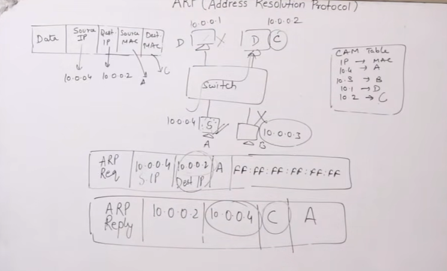

**ARP resolution with router**
---

- hum router ka dono interface pa mac address hoty hein 

- suppose hmary pas 2 devices connect hein aik router ka interface c nam da iska ip da dein `10.0.0.2` aik interface d par `20.0.0.2`
- humy router ka different network mein communication krwany hai aik network pa device A iska ip `10.0.0.1` hai or aik pa B iska ip`20.0.0.1` hoga
- hum **ARP request** jab generate kryein ga tou tou us mein phly source ip `10.0.0.1` phir destination ip`20.0.0.1` likhy ga ismein source mac A da ga or destination mac broadcaast mac dal dein ga
- **ARP Reply** mein humy source ip `10.0.0.2` router interface ka ip or destination ip mein device A ka ip `10.0.0.1` dal da ga or source mac mein apna mac or destination mac pa device ka mac unicast kar da ga.
- device A ko lgy ga ka usy destination mac mil gia hai.
- router ka apna **cam table** hota hai wo ip or mac doono ko save kr la ga.
- yhi process dusry side pa network pa hota hai.
- layer 3 ki chezy change nai hon gi jab ka layer 2 ki hoty jaye gi.

**ab humy agr source ip `10.0.0.1` destination ip `20.0.0.1` mein send krna hai tou router khud hi aik network ka source or destination mac change kar ky dusray network ka source or destination mac mein change kar ky destinaation tak phucha da ga**

**PROXY ARP**
---

- PROXY ARP subnetted ip ka case mein kam krta hai

- router ka dono traf jo ips hon gi wo same class ki hon gi
- is mein b same process hota hai  bas netork id aik hi mein hota hia like router ka dono interface par subnetting ka zariye same network hai. device A ka ip `198.68.1.1` or B ka `198.68.1.69` .
- **ARP REQUEST** source ka ip `198.68.1.1` or destination ip `198.68.1.69` or sorce ka mac address or destination ka broadcast mac id bhj da ga
- router ka pas apna aik routing table hota hai.
- router ka pas jo chz b broadcast aty hai wo isy wesy hii agy forward nai krta 
- **ARP REPLY** ka bad device router ko smjhy gi jesy isy mac requested mac address mil gia .router is ko destination ip sa hi wapis reply da ga jis sa device smjhy gi ka isy requested mac hi mila hai.lkin mac b router ka interface ka hi hoga.
- router aik network sa ai hoi broadcast request forward nai krta blky khud sa ARP request broadcast kar skta hai.
- **ARP REPLY** ka bad router table maintain kar la ga.
- uska bad router data forward krta hai  source ip or destination ip wohi rhy ga bas source mac or destination mac change ho ka agy jaye ga. 

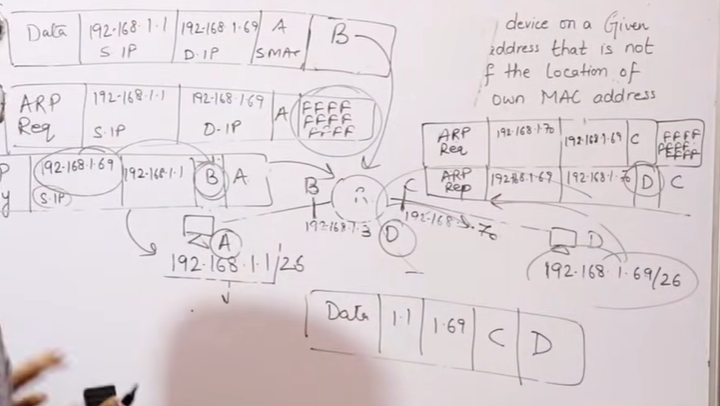

final image
---

- agr humy koi packet aik network sa dusry network mein router ka through send krna tou humy **data, source ip, destination ip, source mac address, destination mac address.**

- yha pa hmary pas bas mac destination avaible nai hai jis ki wja sa hum **ARP REQUEST** **destination broadcast mac** send kar dein ga.
- router wo request agy broadcast nai krta 
- ya **ARP  REPLY** da ga jis mein source ip is device ka hoga jisy hum na destination ip **request** krty waqt  likha tha or destination souce mein bdl da ga or mac address apny interface ka lga da ga.
- device phir router ko apny requested device ka mac smjh ka data forward krta rhy ga 
- router ya process network ki dusry side pa b kry ga
- or phir jo is ka pas data aye ga uska mac address bdl ka agy forward kar dia kry ga.
- jab data destination par phunchy ga tou **source ip or destination ip or source mac or destination** mac ko hta da ga

**GRATITOUS ARP**
---

- ya is liye istemal kia jata hai check krny ka liye network mein 2 computer ko same ip tou nai mil gia khy .

- **GARP REQUEST** ya aik request kry jis mein **source ip , **destination ip b apna hi daly ga** , source mac or destination broadcast mac** daly ga.
- **GARP REPLY**  mein device apna source ip or device ka destination ip , source mac or destination mac dal ka unicast kar da ga.
- **ya hum is waqt istemal krty hein jab hmara ip ka conflict a rha hota hai , packet drop ho rhy hoty hein ya ya show ho rha hota hai ka network mein aik or device ko b yhi ip assign howa hai**.
- agr wo garp reply aye tou ya smjh jata haika ghlty sa kisy or ko b mery ip assign hai.

**REVERSE ARP**
---

**is mein humy mac address pata hota hai lkin ip address ka nai pata hota.**

- jin computer mein ip manually configured nai hoty unhy dhcp server sa request karky dynamically ip lety hain .
- ya **layer 3 protocol** hai
- hum mac address dhcp server ko manually dein  phir hi wo ip address provide kry ga
- iska faida ya b hai ka hum unhy device ka mac address server par daly ga jinhy hum internet provide krna chty hein
- agr hum na aik router ka sth 4 devices connect kar di hein
- in mein aik ko RARP server bna dein ga
- jab b kisy device ko ip chyie tou wo **RARP request** kry ga
- iska sth aik DHCP server lga hoga ya ussy la ka device ko ip provide kry ga.

# LECTURE 21
**WHAT IS WIFI/HOW IT WOEK**
---

- wifi is a transmission medium jo wireless connection provide krata hai

- jesy ka aik laptop ka bluetooth ko on kia or dusry laptop ka bluetooth ko on kia or dono mein data transfer ho rha hota hai
- **wireless fidelity** wifi ka full form define hi nai howa ya misconception hai.
- **VIC HAYES** **father of wifi**
- wifi ka signal US mein stronger hein as compare to europe etc.
- wifi ko  **IEEE 802.11g** standard b kha jata hai
- **IEEE** institution of elctrical and electronics and engineers.jo  technology ka standard and rules develop krty hai.
- 802.11 is ki khani ya hai ka ya 1980 k ferbuary ka mahiny ka andr is standard par baat shiru hoi thy
- jitny ziada frequency ho gi utny wavelength kam ho gi 
- 

**STANDARDS OF WIFI**
---

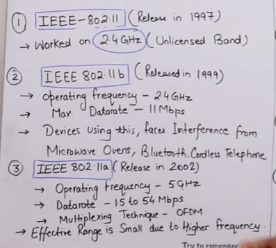

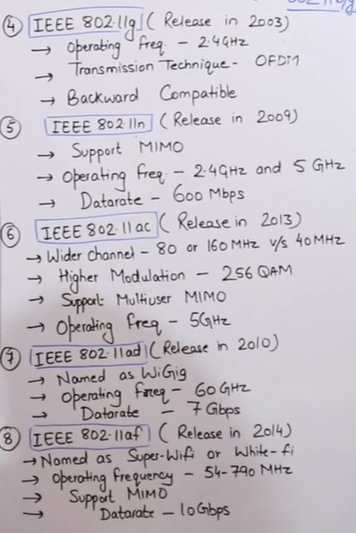

most popular standard **IEEE 802.11n** or **IEEE 802.11ac** version.

1. **IEEE 802.11** 

- ya 1977 ma release howa
- is mein 2.4 GHz use hoty hein
  
2. **IEEE 802.11b** 

- operaating frequency is ki b 2.4 GHz hi hai
- max data rate 11 mbps
- is mein interference ziada hoty thy microwave ovens waqera

3. **IEEE 802.11a**

- ys 5 GHz pa operate hoga
- jitny ziada frequency hogi utny kam wavelenth hogi or jitny ziada frequency  hogi utny ziada wavelength hogi

4. **IEEE 802.11g**

- ya 2.4 GHz pa operate krta hai
- ya backword compatible hai mtlb ka purany version ka sth b kam kar skta hai

4. **IEEE 802.11n**

- ya most popular standard hai
- ya dual standard ko sport krta hai
- mtlb ka compatible hai 
- files ko multiple antennas ka through seend or receive kia jataa hai
- datarate 600 mbps milta hai

5. **IEEE 802.11ac**

- wider channel 
- higher modulation mtlb ka data rate ziada milta hai
- ajkal ya devices mein istemal ho rha hai
- ya 5 GHz ko support krta hai

6. **IEEE 802.11ad**

- ya unlicenced  nai hai blky commercial hai
- isy hum WiGig mtlb wireless giga bit b kehty hein
- operating freqency 60 GHz hai 
- ya 7 Gbps datarate deta hai

7. **IEEE 802.11af**

- isy hum superwifi ya white-fi khty hien mtlb ka ya us band mein kam krta hai jha pa hmary T.V kam krty hein
- iski range bhut bary hai kayi kilometer tak iski range hai
- it operate in 56-790 MHz
- datarate 10 GHz mily ga.

# LECTURE 22 
**FTP(file transfer protocol)**
---

- FTP is an application layer protocol

- hum file ko transfer krny ka liye with the help of internet hum FTP ka istemal krty hein
- hum aik FTP server bnaty hein wha pa files ko internet ka zariye ftp server pa dal dety hein
- network mein hmary user dunia mein khy sa b ftp server sa internet ka zariye connect ho ka files ko ftp server sa download kar skty hein.
- hum **file download** krny ka liye **ftp.example.com** is trha sa kar skty heun
- **user interface** ya koi application b ho skty hai ftp tak phuchny ka liye like **Filezilla,WinSCP,Cyberduck** etc.
- lkin **backend** pa user interface ka 2 connection establish kar rkhy hoty hein **control access + data transfer process** esy hi server ki side pa 2 connection hoty hein
- server ki side pa aik disk hoty jha pa data store hota hai esy hi aik disk user ki side pa hoty hai jha data store hota hai

### CONTROL CONNECTION : 

- control connection like jab hum gmail open krty hein tou wo hum sa phly nam phir password pochta hai 

- ya step by step authentification krta hai
- jab sary chezy verify ho jaty hein tab gmail account chlta hai
- ya secure bilkul b nai hai kiun ka is protocol sa jo data jaye ga wo encrypted bilkul b nai hota
- user apny user id or password ka through yha pa login kry ga agr user valid hai tou ya request ko accept karky responce mein jo file chyie provide kry ga.
- it active thorughout the session mtlb ka jab tak user ko requested data nai mil jtaa connection establish rhta hai ya jab tak wo connection terminate nai krta 
- control connection ka liye port no 21 ka istemal kry ga

### DATA CONNNECTION :

- Hum file ko send krny ka liye data cinnection ka istemal hi krty hein
- data connection ka liye TCP ki port no 20 ka istemal hota hai

**popular FTP Clients** filezilla, WinSCP,CYBERDUCK etc.

- ab ziada tar log dropbox istemal krty hein ftp ki bjaye.

**data structures of ftp**
---

- 1. **FILE STRUCTURE** is mein koi structure nai hota hai data bytes ki form mein continuous save hota rhta hai.
- 2. **RECORD STRUCTURE**  is mein data ko aik sequence sa save kia jata hai isy sequenctial record system b keh skty hein
-  3. **Page structure** is mein data page number ki form mein save hoga .

**transmission mode of ftp**
---

1. **Stream Mode** data continuous form mein transmit hota hai
2. **block mode** block by block data send hota hai
3. **compressed mode** agr file bry hai tou wo isy compressed karky phir send kry ga.

user sa jab data send or retrieve krty wqt in modes ka istemal krta hai

**FTP COMMANDS**
---

- window ka command prompt mein ja ka ftp type karky enter kry

### 1. **transfer file command** 

- **GET** get file from the computer
- **PUT** send one file jab server par dena chyie ya server ya command use kry ga jab wo ya data user ko dena chaye ga
- **SEND** single file send krny kaliye

### 2. **coonnect to the remote host commands**

- **USER** jab user command use kry ga tou wo user ka naam pochy ga phir iska password pochy ga phir isy server sa connect kar da ga
- **OPEN**jo b user address hota hai isy open krny ka liye 
- **PASS** password ka liye hoty hai

### 3. **terminate session command** 

- **CLOSE** connection break ho jaye ga lkin ap server sa disconnect nai hongy hum jo kam kar rhy thy is sy bhir a jaye ga lkin session sa bhir nahi ayein ga
- **QUIT** har chz terminate ho jaye gii session kthm ho jaye ga

**SFTP(secure file transfer protocol)**
---

**TFTP(trivial file transfer protocol)**
---

# LECTURE 23 

**POP3 and IMAP Protocol**
---

**MAIL ko receive krny ka liye **POP3 or IMAP** protocol ko use krty hein**

### **POP3(post office protocol version 3)**

- ya aik pull protocol hai mail ko receive krny ka liye

- hamry server par mail inbox mein hoty hai jab hum download krty hein tou mail wha sa automatically delete ho jaty hai
- agr data **plain text** ki form mein send ho rha hai tou ya **port no 110** ka use kry ga or agr data **encrypted** form mein send ho rha hai rou ya **port 995** ko use kry ga
- iska faida b hai hum offline mail read kar skty  hein or seerver par storage waste nai hota

### **IMAP(internet message access protocol version 4)**

- yha pa mail ko download kiye bagair hum server ko access kar skty hein

- **simple data** use **port 143** or **encrypted data** can use **port 993**
  

# LECTURE 24

**HTTP(hyper text transfer protocol) & HTTPS(secure)**
---

- ya web browser ko web server sa connect krwaty hai
- **proxy** bech mein any waly routers , gateways , firewalls or switches jo kuch b ata hai hum na inhy proxy ka nam da dia
- HTTP is a client server protocol
- **WEB BROWSER & USER AGENT**  jo request krta hai
- **server** nearest server par reqest jaye gi.

**proxies can perform numerous functions**
---

- **caching** it can store data for a certain period  a history
- **filtering** proxy filetring b krty hai kon si request aye gi konsi request  nai aye gi.
- **load balancer** load ko balance kry like adhy request idhr jayein adhhy udhr
- **authentication** user ko authenticate kry ga
- **logging** log in information aye gi ka kab kis kis na log in kia tha

**difference between http and https**
---

- http or https dono he stateless protocol hein mtlb ka jab b hum bank ki website pa koi kam kar rhy hoty hein tou agr url par click kryein ga wo warning da ga ka page refresh ho jaye ga esy session break ho jaye ga 

- ya khud previous jo search hoi hai usy yad nai krta 
- ya dono TCP pa kam krty hein
- http works at application layer while https work at transport layer.
- http does not require any certificate while https required and SSL Certificate
- http use port no 80 https use port no 443.
- http  is stateless not sessionless jesy ka jab hum shopping krty hai tou cart ka option hota hai wha pa
