# **LINUX**
## 01 LECTURE
### **Basic and History of LINUX**

+ In **1964 Bell Labotaries** start a project in **NEW JERSEY** .
  
+ the **purpose** of this project is to make an **operating system** which is **multi-user or multi task** .

+ In **1969** he can **withdraw** his project.

+ withdraw ka bad **Deniss Ritchie or Ken Thompson** na is pa kam karky **UNICS(uniplexed information & computing service)** bnaia.jesy **UNIX** kha jata hai.ya aik free software tha.

+  **1975 UNIX V6** bnaia jo bhut **popular** huwa.

+ **1975-1980** mein hi bhut sary companies na **UNIX**  sa version bna diye.
    1. IBM-AIX
    2. SUN SOLARIES
    3. MAC OS
    4. HP-UX
    5. linux

inhy khty hein **flavor of UNIX.**

***LINUX***
---

linux ka **founder** thy **Linus Torvald** inko uni ki research ka liye aik software chyie tha lkin unix kiu ka purana ho chuka tha or companies is ka paid version mhngy da rhy thy tou unhu na pna operating software bnia **linux** jisy unix ka clone kha jata hai jo esy nai hai inhu na apny professor **Andrew Tanenbaum** na bcho ko prhany ka liye **MINIX** operating system bnaia jisy **prh kar** linus na **linux 1991** bnaia.

+ ya  **open source** tha jo kafy popular howa.
  
+ **1991** mein aik **movemen**t chL rhy thy **free software** ki jis mein **GNU** bna **linux aik kernel** hai **linux + GNU** mil kar kar aik **OS** bna.

agr krnel ka sth koi software mila dein tou operating system bnta hai.

+ linux aik open source software tha jis sa companies na or software bnai
   1. RHEL(redhat)
   2. Fedora 
   3. Debian
   4. kali linux(for hackers)
   5. others(Ubunto,CentOS,Amazon linux)

**Ubunto** dunia ka **3rd sab sa ziada** used hony wala software hai.Ubunto aik african na bnaia . **CentOS** sab sa fastest hai.

_**Operating System**_
--
+ OS ko hum 2 tariqy sa istmal kar skty hein ya tou **CLI(command line interface)** sa ya **GUI(graphical user interface)**.

+ linux ka CLI popular hai.

**Advantages of linux**
--
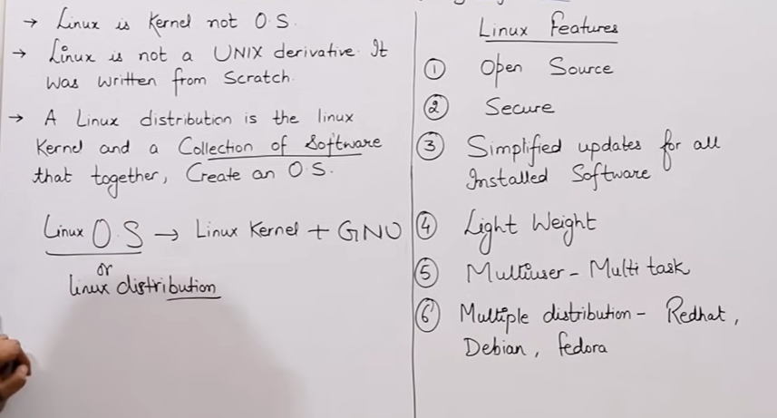

## O2 LECTURE


**Architecture of Window and Linux**


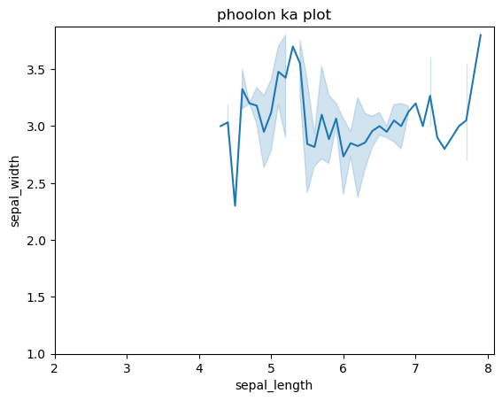

- dono mein main **component hardware** hai
- **window** mein **hardware OS** ka sth interact krta lkin **linux** mein hardware **kernel** sa interact krta hai.
- is ka oper ki dono ki layer ma shell hai shell sa interact krta hai.
- or shell sa user interact krta hai.
- window mein agr MS open krna hai tou user wo request shell sa krta hai shell OS sa or OS jo b hardware require hai isy provide krta hia.
- linux mein similarly kernel request karkky hardware provide krai ga.
- shell user ko respond kry ga.
- **linux mein kam ziada fast hota hai** kiu ka user **direct shell** pa kam kar rha hota hai jabky **window GUI** mein hum jo mouse sa kam waqera krty hein wo backend pa shell mein process ho rha hota hai linux mein hum direct hi cmd sa command da rhy hoty hein.

_**File System Hierarchy**_
--
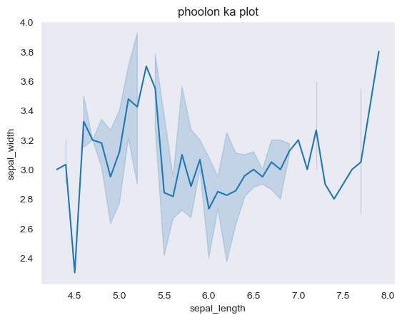

## 03 LECTURE

**LINUX command and it's uses**
--
**how to create a file;**

There are four ways for creating a file;
```
1. Cat command
    - cat > file1 
     
     jo b content likhna hai

     ctrl + d
```

is ka disadvantage ya hai ka hum isy edit nai kar skty.
```
1. touch command
    - touch file1 file2 file3 enter
```
empty file create krny ka liye


3 + 4 (**vi/vim or nano** ya editor hain linux mein)

+ hum koi b file kisy b editor sa open kar skty hein.

**How to start Amazon Linux Machine** 

- hum sab sa phly amazon machine aik **launch** krein ga 

- us ka **putty** ka zariye access lein ga

- phir hum login kry ga **login as : ec2-user**

- ``[ec2-user@ip]$`` aye ga  hum **root user** bny ga ``sudo su(super user do switch user)`` karky.
- ``[root@ip]#``jab root user bny ga tou **$ sign #** ma change ho jaye ga


**cat command**
--
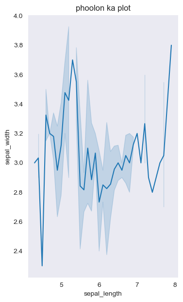

- hum cat sa file bnaye ga command [root@ip]# ``cat > file1`` . **>** ka mtlb hota hai content samny waly file ma bhj do.

- phir is mein kuxh b content likh dein 
- ``ctrl+d`` kry ga tou is file sa bhir ajein ga
- ab file bny hai ya nai ya chk krny ka liye ``ls`` krein ga.
- **content dhkna** ka liye jo likha hai command dein ``cat file1``.
- cat mein hum edit nai kar skty lkin agar kuch or likhna **concatinate** krna hai tou command dein ``cat >> file1`` . 
- agar hum do files ka content **jorna** chty hein tou command dein ``cat file1 file2 > all``
- agar hum aik file ka data dusry file ma copy krein ga tou phly file ka data remove ho jaye ga.
- tac command sa content ult jata hai.

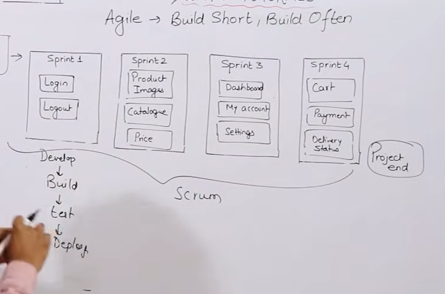

**Touch Command**
---
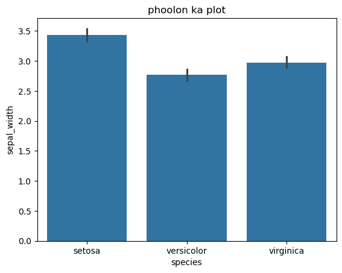

- to check time of file we can write command **stat file1**.

- file **create** krny hai tou likhy ``touch file1`` 
- check krny ka liye ``ls`` kry.
- if we want to **create multiple file** we can write ``touch file1 file2 file3``. 
- if we want to **change time stamp** we can wrote command jis b fille ka time change krna hai uska ``addrees touch file2.``
- if i want to **change access time** so i can write ``touch -a file3``
- if i want to ``change modify time  touch -m file4``.
- we have not any command to change time jsb b hum koi change kry ga tou automatically time change ho jsye ga

**VI editor**
---
- vi is ususally aviable in all version of linux but nano har version  ma nia milta.

- agar **new file** bnana chty hien tou likhy ``vi filea``
- ``i`` ko click krna i click kry ga phr **insert** a jaye ga phir hum likh skty hein
- likhny ka bad ``esc`` kar ka **write** krna hai ``:wq``(w mean save q mean quit) file ban jaye gi.
- agr **file ka content dhkna** chty hein tou **vi sa open nai** krna blky cat sa kro **cat likh ka file ka nam**.
- agr kou chz change krni hai tou **vi** sa hi open kry.
- is mein **navigation** key hoty hain **H J K L** .

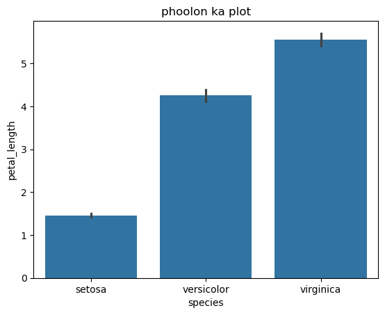

**NANO EDITOR**
---
- File bnany ka liye likhy  ``nano fileb``

- **save** krny ka liiye ``Y`` likkhy or **exit** krny ka liye ``ctrl + X`` .
- **new data** likhny ka liye likkhy ``ctrl+ o`` phr ``ctrl + x`` kar ka **bhir** a jayie.

**in LINUX TERMINAL**
---
- humy ``ec2-user`` type krna hai.
  
- ``ctrl l`` sa screen clear ho jaty hai.

- phir ``sudo su``(super user do switch user) type krna hai
- ``ls -l`` sa ap sary files ki list dhk skty hein. ``ll`` b yhi yhi command hai.
- ``ls -a`` sa hidden files a jaty hein.

- jo command chalyie hon wo dhkny hon tou ``history`` command chlyai. 

## 04 LECTURE
**How to Create directory , copy  , delete , rename .**
---
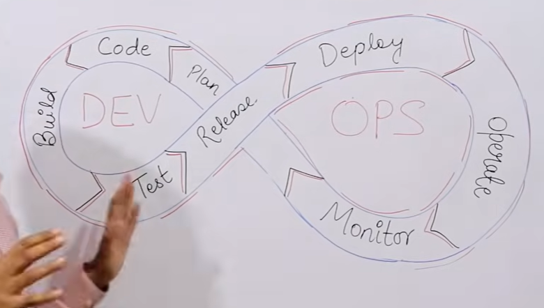

**If we want to make a hidden file**

- we have to make a **hidden file**  ``touch .file1`` just put a dot before file name.

- hidden files dhkny ka liye ``ls -a`` command dein.
- hidden dir b esy tariqy sa bny gi dir ka nam sa phly **.** lga dein.
   
**how to copy file**

- command ``cp file1 file2``  is sa file1 ka data file2 ma copy ho jaye ga

**how to cut and paste file**

- command ``mv file1 dir1`` file1 dir1 ma paste ho jaye gi.

- chk krny ka liye ``cd. dir1`` krein or wha pa ``ls`` command dein.
  
**how to rename file**

- command ``mv file1  myfile`` phla nam phly jo rename kar ky rkhna hai wo bad mein likhy.backeend pa ya cut and paste hi hota hai.

**how to remove file and directory**

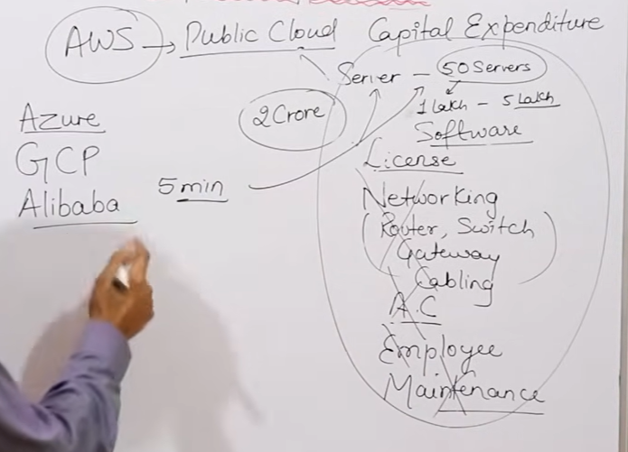

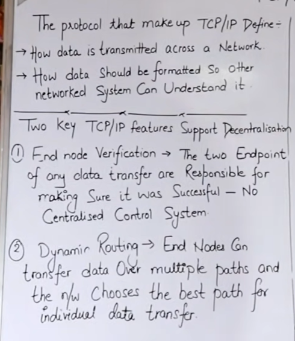

- ``rm -rf dir nam`` mein chyie content pra b hai forcefully delete kaar da gi.

**In LINUX LAB**
---
- ``mkdir`` likh kar agy jo nam rkhna hai rkh dir ka rkh dein.

- ``ls -l`` kry ga tou sary long list ajaye gi idhr **dir or file** ka pata krny ka liye jis **address** mein phly **d aye ga wo directory** hai or jis nein phly **- aye ga wo file ho gi**.
- agar hum ``ls -al`` kary tou hidden files ki long list b ajye gi.
- if we want to make **dir into dir** then the command is ``mkdir -p dira/dirb/dirc`` tou is mein dira mein baqi directories hon gi.
- apny location dekhny ka liye ka ap kha pa hein likhy ``pwd`` . 
- **less more head tail** chalany ka bad ``q`` sa bhir nikkly. 

## 05 LECTURE
**COMMANDS**
---
- command ``hostname`` krny sa apko machine ki details mil jayein gi.

- command ``ifConfig`` sa machine ka ip address ka pata kar skty hein.
- machine ka **ip** address chk krny ka liye ``hostname -i``.
- **OS** ka jo b **version** chal rha hai chk krny ka liye ``cat /etc/os-release``.
- **yum**(yellowdog updater modifyed) aik **software ya pakage** hai jo software ko **install** krny  ka liye ya **remove ya delete** krny ka liye kaam ata hai.
- **httpd**(hyper text transfer protocol daemon) ya command **apache** ki file ko by default install kar deta hai.
- ``yum install httpd -y`` sary files download ho ka install ho jayein gi.
- ``yum remove httpd -y`` sary remove ho jayein gi.
- ``yum update httpd -y`` tou jo files install hein update ho jayein gi.
- apache server ko start ya acticate krna ka liye command hai ``service httpd start -y`` .
- check krny ka liye activate hai ya nai command hai ``service httpd status``
- ``chkconfig httpd on`` command is liye use krty hein ka jab hum computer shutdown krty hein tou software b bnd ho jaaye ga agar hum chaty hein ka wesy hi chlta rhy tou hum ya command use kry ga.
- agr ap chaty hein ka ab mujy iski zrrurt nai hai tou ap ``chkconfig httpd off`` kar dein ga.
- ``yum list installed`` sa sary install pakages ya software ki list ajye gi
- agar koi specific software chk krna ho install hai ya nai tou ``which`` command use krty hein.
- ``whoami`` sa pata lga skty hein ka ap **root user** hein ya **normal user.**
- ``echo  "hello"``  is used to display text or the value of a variable on the terminal.
- echo sa file create b ho skty hai jesy ``echo "welcome" > filez`` is sa **filez** mein welcome ka msg save ho jaye ga.
- echo mein concatinate krny ka tariqa ``echo "new message" >> filez`` tou jo message likh Ho ga wo add ho jayee ga.
- echo sa empty file empty b ban ya ho jaty hai command ``echo > filez``
- ``grep root /etc/passwd`` command use krny sa agar humy  koi specific word findout krna hai tou use krny ga.
- ``sort`` command sa agar file ma jo content hai usy alphabaticaly arrange krna ho tou use kry ga.

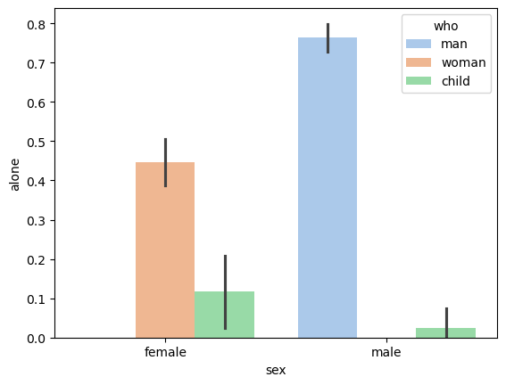

## 06 LECTURE
**useradd,groupadd,gpasswd,In,tar,gzip, and wget**
---

- ``useradd bhupinder`` ya command deny sa hum **user create** kar skty hein 

- ``cat /etc/passwd`` is command sa hum dekh skty hein ka user bna hai ya nai.passwd mein user dekhty hein.
- ``groupadd techguftgu`` is command sa group add ho jaye ga
- ``cat /etc/group`` mein ap group ko dhk skty hein.
- agar ap na koi new user bnaia hai lkin usy group mein add nahi kia tou useer ka automatically group ban jaye ga group ma b user dhky ga.
- ``gpasswd -a aman techguftgu`` **-a** krny sa group mein aik user ko add kar skty hein
- ``gpasswd -M ali,hassan,uzair techguftgu`` **-M** krny sa group mein multiple user ko add kar skty hein lkin ya user exist krty hun wrna ya error da ga
- ``cat /etc/group`` sa hum user dhk skty hein jo jo group mein add hein.
- ``ln -s file1 softfile1`` sa file1 ka **softlink** link ban jaye ga softlink means ka **shortcut** . data jha pra hai wha sa h access hoo ga .
- ``ls -l`` krny sa **softlink > file1** is trha sa dhk skty hein
- ``ln file2 backupfile2`` is command sa ap ki file ki aik **copy hardlink** ban jaye is chz ka **advantage** ya hai ka is sa agar ap file ma kxuh **changing** krty hein tou wo **automatically** hardfile mein change ho  jaye gi agar ap file delete b kar dein tou uska **backup** ap ka pas ho ga.agar hardlink file mein kuxh add kry tou original file mein b copy ho jaye ga.hardlink link nai bnta blky simple file hi bnty hai.
- ``ls`` krny sa dono file ap ki apko nzr ayein gi.
- ``cat >> file2`` kuxh b data add krny ka liye. 
- ``tar -cvf dirx.tar dirx`` **cvf(create verbrose forcefully)**  is command sa hum tar files ya directories bna skty hein.
    - tar mein multiple files ya dir ko jesy window mein zip krty hein isy trha kar skty hein
    - ``ls`` krny sa **dirx.tar** or **dirx** dono dkhy gi dirx mein hum dhky ga dirx phir diry phir dirz jabky dirx.tar mein 3no aik hi jaga mily gi.
    - agr ap  dir pa tar ki command lgaty hein tou wo dir nai blky tar lgny ka bad file ki trha show ho gi 
- ``tar -xvf dirx.tar`` tou **x(extract)** tou dir extract ho jye gi **ls** krny sa sirf **dir** aye ga.
- ``gzip dirx.tar`` tou ya file compress ho jaye gi 
- ``ls`` krny sa ap dhky ga ka ya file ``dirx.tar.gz`` ka ya dir tar b ho gai or compress b ho gai.
- ``gunzip dirx.tar.gz`` is command sa hum files ko unzip kar skty hein.
- ``ls`` krny sa dhka ga  **dirx.tar** file **unzip** ho jae gi.
- ``wget <url>`` koi b file ya software linux machine ma download krny hai tou is command sa kry is sa agar internet slow b hai tou phir b wo bar bar download krny ki koshish krta rhy ga.install ka liye **yum install** waly command use kry ga

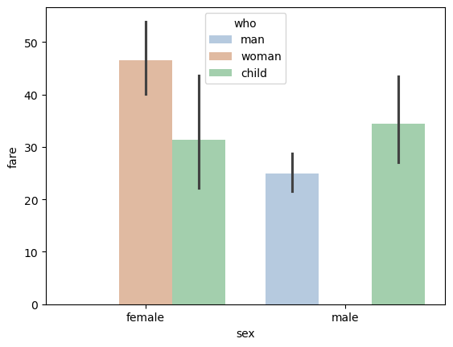

``rm -rf *`` sa sabhy normal files or dir delete ho jayein gi

## 07 LECTURE
**ACCESS MODES/ PERMISSIONS**
---
jab b hum ``ls -l`` likhty hien tou humy kuxh interface dhkny ko milta hai jo ya hai ka

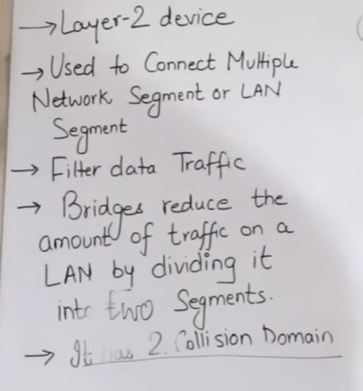

**_ rwx r_x r_ _ 1 root root 0 july 01 04:00 file1**
---
- `_` sa humy pata chlta tha ka ya dir hai ya file

- `rwx` **(read write execute)** owner or root user ka liye hota hai 
- ``r_x`` ya grooup admin ka pass access hoty hai 
- ``r_ _`` is mein jo user ko permissions allow hein wo btai gye hein
- `1` ya symbolic link mtlb ka is file ka kitny softlink bny hoye hain **dir main 2** hardlink bny hoty hein
- `root` is main pata chlta hai ka file ka owner kon hai. root user hai ya hor koi
- `root` agr koi group bnia hi nai hai or ap root user ho tou ap by default root user aye ga.
 - `0` represent file size in byte dir mein ``6`` aye ga kiu ka us mein kuxh hidden files hoty hein
 - `july 01` ya date ko represent krwaye ga
 - us ka bad time 
 - ua ka bad file hai ya dir.

**how to change these permissions**

- `chmod 777 dirx` likhy gy tou **root user, admin, or user** sabhy ko sary permissions mil jayein gi. 
- `ls -l` sa ap dhk skty hein kisy kitny permissions mily hien

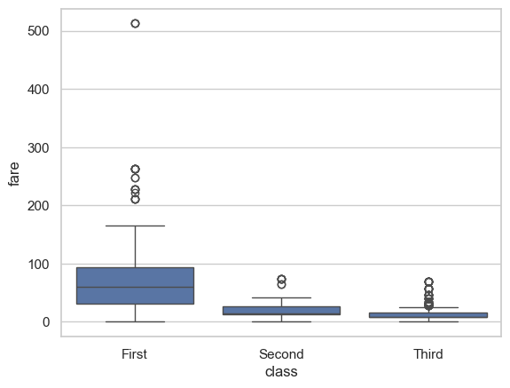
  
**2nd METHOD**
--
u = user/owner

g = group

o = other

``chmod u=r,g=rwx,o=wx file1`` 

- ``u=rwx`` is command sa simple hum user ka ya sary permissions da dein ga.

- ``u + w`` means ka user ko write ki permission da do
- `o - x` means ka other sa excute ko kthm kar do ga

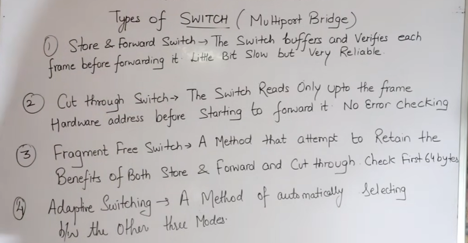

**how to change owner or group**

- `chown bhupinder file1` is sa file ka owner change ho jaye ga.

- `chgrp devops file1` is sa group change ho jaeye ga 
- `ls -l` karky ap dhk skty hein kia kia change howa hai.

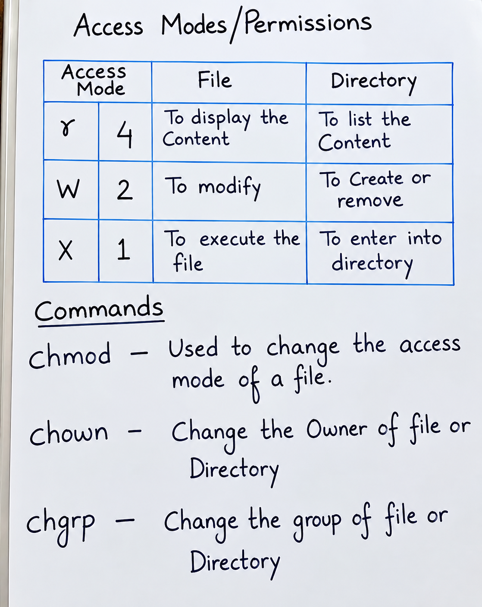